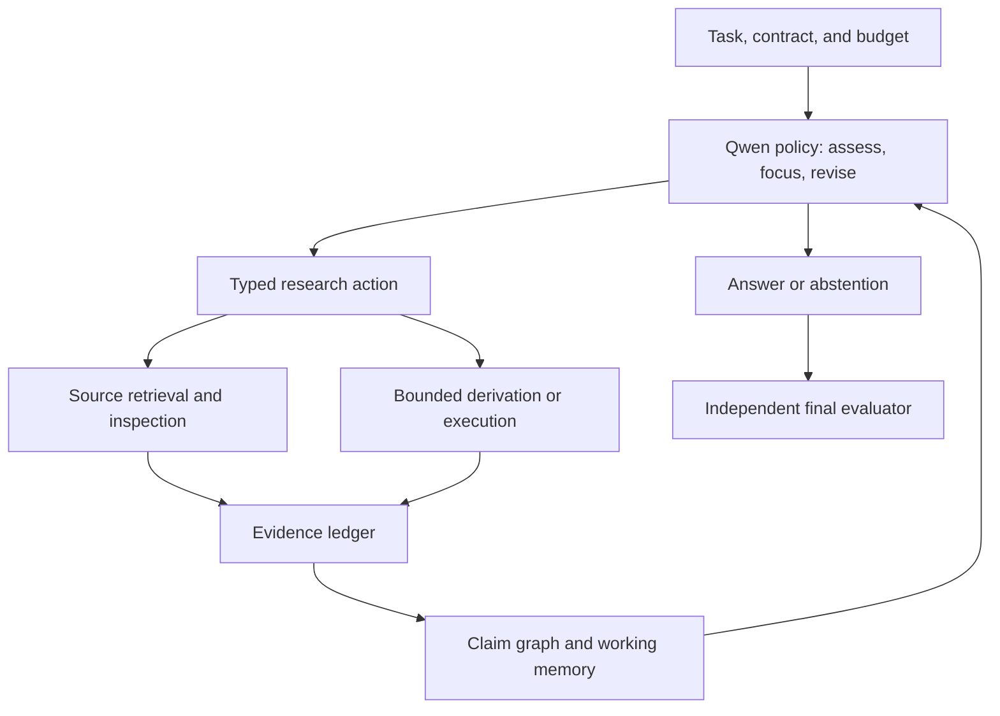

# Learning to Clarify: Research and Development Plan

**Project:** quantum-computing-gpt

**Target:** Qwen/Qwen3.6-35B-A3B

**Date:** 27 October 2026

**Status:** Proposed research and implementation plan; no new model training or efficacy results are reported here.

**Repository baseline reviewed:** [0cec203adcd50197b5e2b3c0e4aaf70df59614a9](https://github.com/xuda1979/quantum-computing-gpt/commit/0cec203adcd50197b5e2b3c0e4aaf70df59614a9)

## 1. Objective

Train a model to turn an incomplete understanding into a defensible answer through focused investigation. Given a quantum-science or programming problem, the model should form a provisional understanding, identify the uncertainty that most affects the answer, retrieve relevant material or run a discriminating experiment, revise its understanding, and stop when the evidence meets the task's requirements.

The intended capability is **learning how to acquire and use missing knowledge**, while retaining enough mathematics, physics, programming, and reasoning ability to interpret that knowledge. Model parameters should increasingly encode reusable research skills; versioned external sources should supply detailed, changing, or rarely used facts. The first deployment remains a quantum research assistant. Transfer to other domains is a later empirical question.

Human learning motivates the design: people often begin with a rough mental model and improve it by directing attention toward consequential gaps. This is an engineering analogy, not a claim that the system reproduces the brain. We will not deliberately make a correct model vague. An initial answer may already be correct, in which case unnecessary research should be avoided.

Large language models also use retrieval, tools, and iterative research. We do not assume that proprietary models know everything initially, and we do not infer their undisclosed parameter counts. The useful question is whether a model of the requested size can achieve better verified results at acceptable total cost by learning a research policy.

**Central hypothesis:** at the same model size, source access, and inference budget, a trained policy that selects decision-relevant uncertainties will outperform both one-pass retrieval and a well-prompted iterative agent.

### 1.1 Observable behavior

| Stage | Required output | Evidence of improvement |
| --- | --- | --- |
| Provisional understanding | Candidate answer or hypotheses, explicit assumptions, unresolved obligations | Separates established facts from guesses |
| Focus selection | One priority question and the observation that could change the answer | Chooses a consequential gap rather than an easy peripheral fact |
| Investigation | A targeted query, source inspection, derivation, or executable test | Obtains relevant evidence within budget |
| Revision | Changed claim, linked evidence, affected dependencies | Corrects a misconception or narrows its scope |
| Completion | Answer, supporting sources/tests, remaining limitations | Meets the contract or explicitly abstains |

“Clearer” means more correct, better supported, and better scoped. Longer explanations and rising self-confidence are not evidence of clarity. Contradictory evidence may properly increase uncertainty before a later resolution.

## 2. Starting point and scope

### 2.1 Model identity and deployment assumptions

The official [Qwen model card][R1] identifies Qwen3.6-35B-A3B as a mixture-of-experts model with approximately 35B total language-model parameters and 3B activated per token. It uses a mixed attention architecture. It is an economical-compute target relative to much larger models, but 35B total parameters still require substantial memory.

The raw two-byte weight estimate is approximately 70 GB, or 65.2 GiB, before other model components, activations, caches, optimizer state, and runtime overhead. Active parameter count does not imply that only 3B parameters need storage. LoRA reduces trainable state rather than eliminating base-weight storage.

Pin the model revision, configuration, tokenizer, processor/chat template, weight hashes, adapter targets, precision, and inference mode before comparison. Use a text-only workflow initially. Inspect the actual model modules and runtime support; do not infer compatible LoRA targets or accelerator support from the model name.

### 2.2 What the repository currently supports

This inventory reflects the reviewed commit, not a fresh target-device validation.

| Existing component | Reusable contribution | Missing capability for this plan |
| --- | --- | --- |
| [Task contracts](../src/quantum_posttrain/contracts.py), [generator](../src/quantum_posttrain/generator.py), [split assignment](../src/quantum_posttrain/splits.py) | Strict one-qubit contracts, generated examples, root-disjoint splits | Research episodes, document provenance, prerequisite graphs, multi-step observations |
| [LLM proposal boundary](../src/quantum_posttrain/llm_boundary.py) | Model proposals cannot assign trusted labels | Research-task adjudication and independent claim checks |
| [Quantum verifier](../src/quantum_posttrain/quantum.py) | Exact small-circuit equivalence up to global phase | Context-sensitive multi-qubit tests, SDK tests, theory obligations |
| [Qwen data formatting](../src/quantum_posttrain/qwen_data.py), [LoRA training](../src/quantum_posttrain/qwen_training.py), [rollout entry point](../scripts/rollout_qwen.py) | Optional supervised training and one-shot candidate evaluation | Multi-turn tool trajectories, tool-token masks, focus supervision, RL, resumable optimizer state |
| [Allocation research](../src/quantum_posttrain/allocation.py) | Scalar checks for verifier allocation and surrogate bounds | Inference-time selection of research actions |
| [Existing validation report](RESEARCH_VALIDATION_REPORT.md) | Recorded CPU and synthetic harness checks | Evidence of Qwen learning, research performance, or distributed/NPU readiness |

The current training path explicitly handles CUDA or CPU; it is not an implemented Ascend training path. Its dependency lower bounds are not a tested Qwen3.6 environment lock. The 16-case fixture and the synthetic 100,000-record plumbing check do not constitute a research benchmark.

### 2.3 Relationship to the existing specification

This plan expands the tool-interaction direction in the [English post-training specification](Qwen36_Quantum_Posttraining_Research_Spec_EN.md), especially Sections 5, 14, and 15. It preserves the [harness-owned problem and rollout boundary](PROBLEM_AND_ROLLOUT_BOUNDARY.md).

For this research direction, prioritize learned investigation and evidence use. Zero-tool distillation remains a secondary experiment: the deployed model is allowed to consult materials. Distill reusable search, verification, and revision skills without making complete factual memorization a prerequisite.

Keep the existing group-level verifier-allocation research as a separate experimental factor. It allocates checks to certify training updates; the proposed focus policy allocates actions to improve an inference-time answer. Their uncertainties, objectives, and evidence contracts differ. Initially hold the training verifier schedule fixed.

This PR supplies a plan and navigation only. Implementation, dataset construction, and accelerator runs are subsequent work.

## 3. Prior art and the proposed contribution

A targeted review of the primary sources below establishes substantial overlap. It does not establish exhaustive novelty or publication priority.

| Prior work | Relevant precedent | What this project must additionally test |
| --- | --- | --- |
| RAG [R2] | Combines parametric generation with external retrieval | Whether repeated, learned investigation improves on the same retrieval resources |
| ReAct [R3] | Interleaves reasoning-related outputs with actions and observations | Whether training the focus and revision policy adds value over a strong prompted loop |
| Self-RAG [R4] | Learns when to retrieve and how to critique generated material | Whether verified, decision-relevant focus improves beyond adaptive retrieval and critique |
| Search-R1 [R5] | Trains multi-turn search behavior with RL and masks retrieved tokens from policy optimization | Whether focus supervision and executable quantum evidence improve on an outcome-trained search agent |
| DeepResearcher [R6] | Trains research agents in real web environments | Whether a bounded single-policy system delivers reliable scientific clarification at lower measured cost |

Search, self-reflection, RL, external memory, and a new name are not independent novelty claims.

The primary research candidate is **decision-relevant focus supervision**. At selected training states, compare several possible investigations under the same continuation budget. Train the model to choose investigations that lead to independently verified improvements, including cases where the most uncertain claim is not the most consequential one.

Two supporting candidates are:

1. **Verified clarification trajectories:** an evaluation and training representation linking provisional claims, acquired evidence, revisions, and final executable obligations. Its value must exceed an ordinary full transcript.
2. **Evidence-preserving working memory:** compression that retains unresolved dependencies and contradictory evidence. Its value must exceed equally sized generic summaries.

These are hypotheses. The main contribution survives only if it outperforms the closest feasible controls with matched data, teacher effort, tools, and compute. Refresh the literature and inspect implementation differences before making a submission claim.

## 4. Research formulation

### 4.1 What the policy observes

Model an episode as a partially observed decision process. The underlying scientific facts and correct solution are not generally known to the policy. At step $t$, the available state is

$$
s_t = (x, C_t, E_t, M_t, b_t),
$$

where $x$ is the public task and contract, $C_t$ is a structured claim/dependency ledger, $E_t$ is accessible evidence, $M_t$ is bounded working memory, and $b_t$ is remaining budget.

This is an engineering state representation, not a proven sufficient statistic. Compression can discard information; evaluate that loss explicitly. Hidden answers and final evaluation tests never belong to $s_t$.

Distinguish four reasons for uncertainty:

- **Missing evidence:** an external definition, assumption, API detail, or result is needed.
- **Conflicting evidence:** sources disagree, apply to different versions, or use different conventions.
- **Unclear task specification:** the requested output or assumption is ambiguous.
- **Capability limitation:** the model cannot complete a derivation or interpret the evidence.

A further search may resolve the first case but fail to resolve the others. Sampling noise in a simulation is a separate statistical uncertainty; it requires an appropriate estimator and sampling contract.

### 4.2 Focus as expected improvement in the decision

Let $U(d,z)$ measure the utility of decision $d$ when the relevant unknown state is $z$. Under an ideal belief $p_t$, the value of investigation $a$ is

$$
\operatorname{VOI}(a\mid s_t)
=
\mathbb{E}_{o\mid s_t,a}
\left[\max_d \mathbb{E}[U(d,z)\mid s_t,a,o]\right]
-
\max_d \mathbb{E}[U(d,z)\mid s_t]
-
\lambda^\top c(a).
$$

Here $o$ is the possible observation and $c(a)$ records resource costs. The true beliefs, observation distribution, and optimal decisions are unavailable in practice. This equation defines the intended objective; it is not an optimality guarantee for our model.

The implementable first approximation is a ranking over a small action menu. Features include unresolved obligations, dependency on the final answer, source disagreement, availability of a discriminating check, and measured action cost. Estimate value from verified branch outcomes on training roots, then learn to generalize the selection rule. Compare against uncertainty-only, cheapest-first, and uniform focus selection.

Do not reward entropy reduction alone. A confident wrong answer can have low entropy, and a new contradiction can make the investigation more useful while increasing uncertainty.

### 4.3 When to stop

An episode may end with:

- **ANSWER:** the public completion requirements are met and the model supplies a scoped result.
- **ABSTAIN:** important obligations remain unresolved and no affordable useful action is available.
- **BUDGET_EXHAUSTED:** a hard limit is reached; preserve the partial result and unresolved obligations.
- **INFRASTRUCTURE_ERROR:** the run cannot be measured; preserve the failure record.

Learn answer/continue/abstain choices, while the harness enforces hard limits. A learned value estimate alone cannot certify a scientific claim. Confidence thresholds must be calibrated on development data and evaluated under distribution shift.

## 5. Architecture and information boundaries

Use one trainable Qwen policy initially, with deterministic orchestration and separately controlled evidence services. This keeps the mechanism measurable and avoids confusing gains from model training with gains from adding more agents.

### 5.1 Policy outputs

Use a small typed action vocabulary:

| Action | Policy responsibility | Harness responsibility |
| --- | --- | --- |
| ASSESS / SELECT | State candidate hypotheses and choose one unresolved obligation | Validate references and budget |
| SEARCH / READ | Form a focused query or select a document span | Retrieve from the permitted corpus and record source/version |
| DERIVE | Produce a concise derivation or candidate proof | Route checkable claims to the appropriate verifier |
| EXECUTE / VERIFY | Propose a small discriminating program, simulation, or public check | Execute in isolation and return authentic diagnostics |
| REVISE | Update a claim and explain the evidence dependency briefly | Append the revision; preserve contradictory and superseded records |
| COMPRESS | Propose a compact working-state summary | Preserve evidence identifiers and required unresolved obligations |
| ANSWER / ABSTAIN | Return a result with scope and evidence | Close the episode and invoke the separate final evaluator |

The learner produces concise decision records, source references, and checkable derivations. Training does not require inaccessible private reasoning from a teacher. A teacher's fluent explanation cannot substitute for an observed tool result.

### 5.2 Claim and evidence ledgers

Each claim records its identity, statement, assumptions, dependency IDs, unresolved question, supporting and contradicting evidence IDs, proposed status, confidence estimate, and revision history.

The harness owns authenticated verdicts. A policy can propose “supported,” but cannot manufacture a verified status. Store the model's confidence separately from verifier evidence. Confidence becomes a probability only after an explicit calibration procedure demonstrates useful calibration on the relevant distribution.

Evidence records contain source URI or tool ID, content hash, retrieval time, document revision, exact span or artifact reference, query/action hash, candidate hash where relevant, environment/version, and verdict scope. A document may support a definition; it does not automatically prove that generated code satisfies that definition. Multiple mirrors of the same source are not independent corroboration.

### 5.3 Three kinds of memory

| Memory | Contents | Update rule |
| --- | --- | --- |
| Model parameters | Mathematical primitives and learned investigation skills | Offline, versioned SFT/RL updates |
| Episode working memory | Current hypotheses, evidence pointers, dependencies, unresolved conflicts | Bounded updates during one episode |
| External persistent memory | Versioned source documents and independently checked reusable findings | Explicit provenance and acceptance gates |

No automatic weight update occurs during a test episode. Persistent memory begins read-only in the main benchmark. A later continual-learning study uses chronological tasks, separate memory versions, and a clean evaluation to prevent test answers from leaking into later tasks.

Use an append-only event log plus structured records for metadata, a content-addressed store for source spans and tool artifacts, and lexical/vector indexes for retrieval. A vector hit supplies a candidate source, not a truth label. Evict irrelevant text from active context while preserving recoverable evidence pointers.

Compression must retain pending obligations, assumptions, contradictions, and links to checks. Repeated summaries must not turn a provisional claim into an established fact. All source re-reads and summary generation count toward the episode budget.

### 5.4 Trust boundaries

Retrieved documents and candidate code are untrusted data. Source text cannot redefine the task, tool permissions, reward, or evaluation rules. The retrieval service may access approved sources; the code-execution sandbox has no general network access and cannot read hidden references, training secrets, or the final evaluator.

Keep public development diagnostics separate from sealed final tests. Repeated public checks consume budget and never expose final-test labels. Use explicit time, memory, process, and output limits; a forged “PASS” in model or tool text is not a verifier result.

## 6. Worked quantum example

**Task:** decide whether two subroutines may be substituted inside a coherently controlled circuit.

1. **Rough understanding.** The policy recalls that global phase is unobservable for a standalone unitary and tentatively considers $U$ and $V=e^{i\phi}U$ interchangeable.
2. **Identify the gap.** The contract involves a controlled operation. The important question is whether the same equivalence relation survives that composition. Searching for more general definitions of a qubit is low value.
3. **Inspect evidence.** The policy retrieves the definition of controlled-$U$, records the convention, and constructs a small matrix witness.
4. **Run a discriminating check.** For $U=I$ and $V=e^{i\phi}I$, prepare the control in $|+\rangle$. Controlled-$V$ changes the control's relative phase, giving $\langle X\rangle=\cos\phi$, while controlled-$U$ gives $1$.
5. **Revise the claim.** Standalone equivalence up to global phase does not generally justify substitution inside a controlled context. Equality is recovered when the relative phase is a multiple of $2\pi$, under the stated conventions.
6. **Answer and preserve scope.** Provide the condition, witness, and verification artifact; abstain if a larger task still contains unchecked obligations.

This is an illustrative analytic case, not an observed trained-model trajectory. It connects to the repository's existing [contextual witness implementation](../src/quantum_posttrain/contextual.py). The new research question concerns whether the model learns to select this check on unseen problems.

Use additional families involving bit ordering, measurement versus unitary semantics, ancilla reset assumptions, noise-model mismatch, SDK version changes, and theorem assumptions. Verify each family's oracle independently before using it for positive training labels.

## 7. Data program

### 7.1 Build episodes around genuine information needs

Start with six task strata:

| Stratum | Information gap | Independent evaluation |
| --- | --- | --- |
| Known and simple | No material missing information | Exact answer and unnecessary-call rate |
| Missing fact or convention | Relevant detail exists in permitted material | Correct use of the identified detail |
| Multiple dependent gaps | Several facts or checks must be combined | Final contract plus prerequisite obligations |
| Misconception or contradiction | A plausible initial belief conflicts with evidence | Correct revision and resistance to misleading sources |
| Research-to-code | Retrieved assumptions must become executable behavior | Hidden executable tests under a pinned environment |
| Insufficient information | Available evidence cannot resolve the task | Correct abstention or qualified conclusion |

Do not force every task to require search. Do not fabricate a “vague” starting response and then count its repair as a model improvement. Collect the policy's actual initial response. Use controlled incomplete-information tasks alongside natural problems, and report the two separately.

Use licensed or otherwise authorized snapshots of official SDK documentation, research material, and curated derivations. Candidate source entry points include the official [Qiskit documentation](https://quantum.cloud.ibm.com/docs), [Cirq documentation](https://quantumai.google/cirq), and [PennyLane documentation](https://docs.pennylane.ai/). These are source candidates, not a claim that a corpus has been downloaded or cleared for redistribution. Record version, license, reuse scope, parsing quality, and source family before ingestion. Public availability alone is not a redistribution license.

LLMs may propose problems and wording. The harness reconstructs accepted contracts, independently checks answers, and preserves lineage; semantic review is required when automatic verification cannot establish that the wording matches the contract.

### 7.2 Split before generation and retrieval

Assign splits at the root and source-family level before creating variants, translations, teacher traces, summaries, embeddings, or cached retrieval outputs. Quarantine all derivatives together.

For the main mechanistic test, hold out problem roots. Add a stronger transfer slice with unseen source families, document versions, or convention systems. Generic shared reference documents can be allowed in a declared standard-RAG track; record that overlap. In the source-disjoint track, neither those source families nor their derivatives enter training. Evaluation sources may still be available to the policy through its permitted test-time retrieval service.

Exclude benchmark solutions, answer keys, hidden tests, teacher completions, and prior evaluation logs from retrieval. Audit both indexed text and caches. Use canary strings and nearest-neighbor audits to detect leakage. A timestamp split alone does not demonstrate absence from a model's pretraining data.

Create a controlled **new-information** slice: evaluator-authored documents define unfamiliar but coherent APIs or mathematical conventions after the model is frozen. Judge with independently implemented tests. Compare source-present, source-withheld, and misleading-source conditions. This tests whether the system uses available evidence; it does not prove that all real-world facts are novel to the model.

### 7.3 Initial quantities and admission gates

The following are planning ceilings and targets, not existing datasets:

- Pipeline pilot: 120 reviewed development roots, about 20 per stratum; no final claim.
- Initial SFT pool: target 2,000 training roots and up to 6,000 audited trajectories, including valid direct answers, revisions, and unsuccessful attempts.
- Development/calibration pool: 300 disjoint roots; keep calibration records separate from policy-fitting batches.
- Sealed evaluation: provisional target 1,200 roots, approximately 200 per stratum, with the final allocation set by a development-only power analysis.
- Focus-branch study: begin with 200 training states and three candidate investigations per state. Expand only after adjudication and cost checks pass.

Source families, not paraphrase counts, determine effective diversity. Increase the sealed sample before evaluation if power is insufficient; never generate more variants merely to inflate the independent sample count.

Admission requires a valid contract, source rights, known split, deduplication, replayable evidence, authentic tool outputs, and final adjudication. Preserve rejected and failed trajectories with reasons. Failure examples need appropriate rejection/revision targets; do not imitate failed actions as successful demonstrations.

### 7.4 Episode record to implement

Each versioned record must include:

- episode/task/root/source-family/split IDs and contract hash;
- model, adapter, tokenizer, prompt, inference mode, seed, and behavior-policy revision;
- corpus/index manifest, source timestamps, and cache state;
- the public task, initial answer, claim ledger, and action/observation events;
- actor-token and observation-token boundaries, masks, and behavior log probabilities when needed;
- evidence links, claim revisions, compression events, budget consumption, and stop reason;
- final answer, independent verdict, scoring-contract hash, and infrastructure disposition.

The evaluator appends final verdicts outside the policy-visible transcript. Reject missing provenance or malformed records rather than filling them with plausible defaults.

## 8. Training program

Train reusable investigation behavior, not a script that always searches. Keep task validity and final scoring under the trusted harness throughout.

### 8.1 Stage A: establish the pre-adaptation baselines

Run the pinned model with direct answering, one-pass RAG, and a carefully prompted research loop before training. Use the same source snapshots and declared budgets. Inspect failures to distinguish retrieval failure, source interpretation, bad focus, faulty revision, and insufficient reasoning ability.

An oracle-evidence condition supplies the necessary permitted passages without search. If the model still fails badly, better search selection alone is unlikely to solve the problem. Address interpretation or foundational capability before scaling RL.

### 8.2 Stage B: supervised research trajectories

Begin with LoRA on the existing post-trained checkpoint. Use reviewed trajectories containing actual tool calls and observations, concise claim updates, direct answers when sufficient, and justified abstentions.

Optimize next-token loss on policy-authored actions, decision summaries, revisions, and final responses. Mask system prompts, user inputs, retrieved documents, and execution outputs from target loss. Observations remain available as context. Keep privileged evaluator annotations outside policy-visible inputs entirely; loss masking alone does not prevent information leakage. Validate masks with sentinel tokens and independently counted token spans.

Teach a curriculum from single missing facts to prerequisite chains, contradictory sources, research-to-code tasks, and unfamiliar conventions. Mix in ordinary mathematics/programming tasks to measure and limit regressions. Do not train on sealed evaluation records.

Start with adapter rank 8 or 16 only after module discovery and a memory canary; compare a small development-selected configuration set. A specific rank or learning rate is an experimental choice, not an established optimum. Save optimizer, scheduler, random-number, sampler, and data-cursor state in addition to adapter weights.

### 8.3 Stage C: learn which investigation matters

At a training state:

1. Propose three feasible investigations, including a sensible alternative such as direct completion when appropriate. Use the same action-generation procedure across compared methods.
2. Fork an immutable copy of the public state and remaining budget for each candidate.
3. Execute the candidate, then use a fixed continuation policy and matched continuation budget. Pair continuation seeds where practical and record all branches.
4. Independently score terminal correctness, evidence validity, and total cost.
5. Create a focus target or pairwise preference only if the observed difference is reliable enough. Label near-ties as unresolved instead of inventing a ranking.
6. Train SELECT behavior on the adjudicated choice and retain the full branch outcomes for audit.

This estimates value relative to the sampled action menu and continuation policy. It does not reveal the globally best research action. Record branch sampling, uncertainty, and selection bias. Offline evaluator access can supply training labels, but its privileged information must never enter policy-visible state.

Use a matched control with the same roots, branch exposure, verified final answers, teacher tokens, and update budget, but without focus-ranking targets. This separates useful focus supervision from simply buying more successful examples.

A later action-value predictor is optional. First establish that supervised selection beats simple heuristics and outcome-only training.

### 8.4 Stage D: bounded multi-turn reinforcement learning

Run on-policy groups from frozen training roots only after the trajectory and target-device lifecycle passes. Begin with group size 4 and synchronized rollout/learner weights. A research episode, rather than a single final completion, is the unit of reward and accounting.

A simple initial reward is

$$
R_i = Y_i - 0.05 C_i - 0.05 F_i,
$$

where $Y_i\in\{0,1\}$ is independently adjudicated contract success, $C_i\in[0,1]$ is normalized measured resource consumption, and $F_i\in[0,1]$ is the fraction of asserted evidence links found fabricated. Define cost as a weighted sum of capped resource-to-budget ratios with nonnegative weights summing to one; freeze those weights and denominators on development data. Set the fabrication fraction to zero when no evidence links are asserted, while still requiring mandatory evidence for success. Fabricated evidence that is necessary to satisfy the contract invalidates $Y_i$; severe provenance or permission violations invalidate success outright.

For answerable tasks, abstention has $Y_i=0$. For explicitly adjudicated insufficient-information tasks, an appropriately scoped abstention can have $Y_i=1$. The policy is not told which evaluation stratum supplies that label. This reward preserves a gap: a successful episode scores at least 0.90, while an unsuccessful episode scores at most 0. Report correctness and abstention separately so the mixture cannot hide avoidance.

Start with terminal reward only. No bonus is awarded for verbosity, number of searches, self-declared clarity, or rising confidence. Add step-level shaping only as a separate ablation with independently verified labels; do not repeat terminal success at every turn.

For complete groups of $G$ episodes, use $A_i=R_i-\frac{1}{G}\sum_j R_j$. A baseline clipped objective is

$$
J(\theta)=\frac{1}{G}\sum_i\frac{1}{N_i}
\sum_{k\in\mathcal A_i}
\left[
\min\!\left(\rho_{ik} A_i,\operatorname{clip}(\rho_{ik},1-\epsilon,1+\epsilon)A_i\right)
-\beta D_{\mathrm{KL}}\!\left(\pi_\theta(\cdot\mid h_{ik})\Vert\pi_{\rm ref}(\cdot\mid h_{ik})\right)
\right].
$$

Here $\mathcal A_i$ contains only policy-generated tokens, $N_i=|\mathcal A_i|>0$, $h_{ik}$ is the actual history including observations, and $\rho_{ik}$ is the current-to-behavior probability ratio of the sampled action token. Pin the reference policy; record the exact KL implementation or any estimator and validate it independently. Use a stable log-probability calculation and explicit clipping configuration.

This equal-episode normalization is a baseline choice, not a new GRPO result. Test length sensitivity against a documented alternative. Preserve complete groups and all unsuccessful members. Quarantine groups with infrastructure-invalid evidence; report their incidence. Do not silently train only on fast or successful episodes. Record zero-variance groups, truncation, parse failures, and policy-version mismatches.

### 8.5 Stage E: calibration and memory consolidation

Calibrate claim/final-answer confidence on a held-out development-calibration set using a predeclared post-hoc mapping or separately validated head. Measure Brier score and risk versus answer coverage. Token entropy and verbal confidence are diagnostic features, not truth probabilities.

Consolidate only independently checked findings into versioned external memory. Distill successful research skills and verified repairs into a new adapter only through a controlled offline dataset. Compare against equal-volume final-answer-only SFT and ordinary repair training. Keep the main test read-only and free of between-task adaptation.

Optional zero-tool distillation measures how much skill transfers without tools. It is not a condition for declaring the tool-using research assistant useful.

## 9. Evaluation and falsification

### 9.1 Baselines that separate the mechanisms

| ID | System | Purpose |
| --- | --- | --- |
| B0 | Pinned Qwen, direct answer, no tools | Measures initial competence |
| B1 | Same model with one-pass retrieval | Measures ordinary external knowledge access |
| B2 | Same model with a tuned prompted research loop | Separates training gains from orchestration |
| B3 | Research-trajectory SFT with the same action interface | Measures trajectory imitation |
| B4 | SFT plus outcome-only search RL, same ledger and memory as the candidate | Closest learned-search control |
| C | B4 plus decision-relevant focus supervision | Primary mechanism comparison |
| O | Same model with oracle-selected permitted evidence | Diagnoses retrieval versus interpretation limits |
| L | A stronger available model with matched tools, plus its practical deployment setting | External reference; not the causal proof |

Choose the strongest feasible same-size comparator using development data before opening the sealed evaluation. The incremental focus claim specifically requires C versus B4. If B4 is unavailable, report a narrower comparison and withhold that claim. Label adaptations of published methods as adaptations, not exact reproductions.

Train C and B4 with matched roots, source access, branch exposure, policy architecture, ledger/memory representation, teacher effort, and optimizer/token budgets. Give comparators comparable tuning effort. Account for expensive focus labels in training cost.

For inference, match corpus/index, available tools, public diagnostics, prompt/template where applicable, active context, reasoning mode, decoding, aggregate generated tokens, observation tokens, input-token processing, call limits, and wall-time caps. Report actual use as well as caps. B0 and B1 naturally consume less; compare them on quality-cost curves rather than pretending equal upper limits imply equal spend.

For an external reference model, record exact product/model version, date, permitted input disclosure, tool configuration, latency, and cost. Do not infer memory size or claim equivalence to all frontier models from one comparison.

### 9.2 Primary outcome and decision rule

Use the existing specification's separation of science and coding. On answerable tasks, define

$$
S=0.5\,S_{\rm science}+0.5\,S_{\rm code},
$$

with preregistered macro weights over task families inside each category. Executable results and fully adjudicated scientific obligations define success. Open-ended research quality receives a separate blinded expert rubric and is not silently merged into exact correctness.

Count malformed answers, unsupported mandatory claims, candidate-caused timeouts, and abstentions on answerable tasks as failures. Insufficient-information tasks form a separate abstention guardrail.

Set the practical improvement target from the development baseline, then freeze it:

$$
\delta_{\min}=\min\!\left(0.10,\;0.20(1-S_{B,\mathrm{dev}})\right).
$$

The proposed primary gate is a point improvement of at least $\delta_{\min}$ over the chosen matched comparator, with a positive lower endpoint of the paired 95% interval. This is an engineering target, not a universal publication criterion. If the development score is at ceiling, redesign the benchmark before sealing it rather than accepting a zero-gain target.

Run three independent training seeds for the final candidate and nearest trained control if claiming a stable training benefit. Retain all seeds; choose no winner using test results. Report per-seed results and a prespecified hierarchical paired analysis that accounts for seed variation and source-family/root clustering. Paraphrases and multiple trajectories are not independent test units. Use the development pilot to estimate power and freeze the analysis before testing.

### 9.3 Metrics for “becoming clearer”

| Metric | Definition or interpretation |
| --- | --- |
| Success versus budget | Verified completion at 0, 2, 4, and 8 external calls, with token and time use |
| Recovery from an initial error | Among initially wrong answerable cases, fraction correct at completion |
| Harmful revision | Among initially correct cases, fraction made wrong during research |
| Evidence support and coverage | Precision of asserted evidence links plus coverage of required claims |
| Focus regret | Difference from the best evaluated action in the bounded branch menu, with continuation uncertainty |
| Confidence calibration | Brier score, reliability curves, and risk at matched answer coverage |
| Appropriate abstention | Abstention precision/recall on the insufficient-information slice and false-abstention rate elsewhere |
| Research efficiency | Verified success per measured accelerator-hour, token budget, and wall time |
| Memory fidelity | Recovery of required evidence/dependencies after compression; lost contradictions |
| Robustness | Performance under distractors, contradictory/stale documents, missing sources, and tool failures |

Record the initial answer before tool access and use independent scoring afterward. To inspect intermediate checkpoints, an offline evaluator may score frozen prefixes, but its feedback must never influence the live episode. Count any extra answer-generation work used by a checkpoint probe separately.

Do not require every episode's score or confidence to improve monotonically. Measure distributions of helpful and harmful revisions, plus the final quality-cost tradeoff. A lexical “clarity score” or a self-reported confidence curve is insufficient.

### 9.4 Essential ablations and negative controls

1. Remove focus supervision while preserving all other training information and budgets.
2. Replace focus selection with random, uncertainty-only, and cheapest-first policies.
3. Compare structured memory with equally sized generic summaries and an uncompressed transcript under the same context cap.
4. Remove contradiction retention while keeping capacity fixed.
5. Replace executable intermediate checks with text feedback; keep the final evaluator unchanged.
6. Supply the same passages in a fixed order to separate retrieval quality from interpretation.
7. Withhold or corrupt the decisive evidence and test whether the answer changes appropriately.
8. Evaluate novel conventions/APIs with sources present and absent.
9. Compare full C with B4 at several matched realized-cost operating points.

Run ablations in stages rather than an unaffordable full factorial. Prioritize the focus removal and matched-data controls. Secondary hypotheses require predeclared multiplicity handling; do not select only favorable task slices afterward.

### 9.5 Guardrails and missing measurements

Proposed guardrails are a two-percentage-point noninferiority margin on general mathematics/programming tasks, no material degradation in confidence calibration at matched coverage, and no unexplained failure concentrated in a priority quantum family. Freeze practical margins from development data and report uncertainty. Unsupported-answer risk must not be hidden by increased abstention.

Use PASS/FAIL for measured outcomes, VOID for invalid infrastructure or evaluator records, and UNKNOWN for unresolved evidence. Candidate-caused resource exhaustion is a failure. Retry infrastructure faults only under a fixed recorded policy. Reconcile every scheduled task and report residual VOID/UNKNOWN counts, conservative bounds, and coverage. Withhold the primary conclusion while missing measurement could reverse it.

A failed hypothesis remains useful evidence. If C does not improve on B4, retain the simpler system and report that focus supervision did not demonstrate incremental value under the tested conditions.

## 10. Resource and runtime plan

### 10.1 Initial episode limits

These are proposed pilot settings to freeze after development profiling, not validated deployment limits.

| Resource | Initial ceiling |
| --- | --- |
| External SEARCH/READ/EXECUTE/VERIFY calls combined | 8 per episode |
| Policy decision rounds | 12, including completion |
| Policy-generated tokens across the episode | 8,192 |
| External observation tokens across the episode | 16,384 |
| Active context at any decision | 16,384 tokens |
| Cumulative input tokens processed across all model calls | 131,072 |
| Working-state summary | 2,048 tokens within the context cap |
| Main exact-task episode wall time | 180 seconds |
| Code-execution sandbox | 30 seconds, 2 GiB RAM per call initially |

The active context includes task, instructions, summary, retained evidence, and available generation headroom; the harness must reserve space before generating. Re-reading, compression, failed calls, and repeated prompt processing count toward cumulative budgets. A long-proof or simulation track gets a separate frozen profile and must not be pooled into the fast-track cost claim.

The compact context is a research choice, not the model's advertised maximum or a proven optimum. Compare a larger context on development data and report any quality sacrificed by compression.

### 10.2 Compute phases and capacity gate

Use CPU fixtures for contracts and replay, then a small-model lifecycle smoke where useful, then the requested 35B target. A smaller-model result cannot stand in for a Qwen3.6 result.

Provisional per-stage ceilings are 24 accelerator-hours for runtime/canary work, 128 for initial SFT, 256 for RL pilots, and 128 for bounded evaluation. These are stopping budgets for planning; they are neither measured runtime estimates nor authorization to launch jobs in this documentation change. Multi-seed publication experiments and large label generation require a new cost estimate after throughput is measured.

Inspect actual available hardware. For Ascend, validate the driver/CANN/torch-npu stack, model kernels, distributed communication, LoRA injection, rollout engine, and trainer compatibility on the exact devices. Inference support alone does not prove backward-pass or distributed-training support. Test CUDA separately if used. Freeze a working environment rather than relying on broad dependency minima.

Measure resident weights, peak training memory, activation/cache use, adapter/optimizer state, rollout concurrency, and checkpoint overhead. Require headroom before scaling. Initially serialize rollout and training if co-residence is unsafe; do not assume that a particular number of NPUs fits.

Estimate cost from measured useful tokens/second, episode completion rate, and verifier latency. Include source indexing, teacher/branch generation, retrieval, failed runs, and evaluation. Report accelerator-hours by hardware type; unlike devices are not interchangeable units of work.

### 10.3 Reproducibility, recovery, and stopping

Every run records code/model/data/environment hashes, resolved configuration, seeds, budget, scoring contract, and parent checkpoint. Persist each tool result and action ID so resume reuses committed observations without repeating side effects. Checkpoint training state atomically and prove fresh-process reload and resume.

Before expansion, pass load → batch → forward → loss → backward → parameter update → save → terminate → resume → evaluate on the target runtime. Monitor finite loss/gradients, parameter changes, tool validity, coverage, reward-versus-independent-score gaps, memory, cost, and liveness.

Pause on evaluator leakage, fabricated evidence acceptance, nonfinite training, incomplete groups, adapter/version mismatch, repeated tool loops, corrupt checkpoints, or budget exhaustion. Preserve diagnostics and the last valid checkpoint. Repair and revalidate before resuming; do not hide failures by repeatedly restarting unchanged jobs.

## 11. Implementation roadmap

All work packages below are **planned**. Dependencies and exit evidence, rather than calendar promises, determine progress.

| Work package | Depends on | Proposed implementation | Exit evidence |
| --- | --- | --- | --- |
| P0: freeze experiment contract | Repository audit | Model/runtime/source inventory; baseline and budget definitions | Resolved manifests, available hardware, known limitations |
| P1: episode and evidence contracts | P0 | New research record types, immutable event log, typed tool boundary | Replay, malformed-record rejection, provenance and isolation checks |
| P2: corpus and research tasks | P1 | Source snapshots/index, reviewed roots, split and contamination audit | Pilot tasks with independent oracles; sealed evaluation manifest |
| P3: prompted loop and baselines | P1–P2 | Budgeted episode runner; direct/RAG/iterative modes | Complete baseline records; oracle-evidence diagnostic |
| P4: multi-turn SFT | P3 | Token masking, data loader, target LoRA lifecycle | Mask audit, save/resume, development and retention results |
| P5: focus supervision | P3–P4 | Matched branch runner and adjudicated focus targets | Menu-level value estimates; matched-data control |
| P6: outcome RL and focus candidate | P4–P5 | Complete-group training and independent reward audit | C versus B4 development results and cost accounting |
| P7: sealed evaluation and release decision | P6 | Frozen comparisons, ablations, calibration and robustness analysis | Reproducible report, uncertainty, limitations, promotion/rejection |

Assign one accountable owner and one writer per component. Independently review claim-bearing reward, split, verifier, and statistical analysis changes.

Suggested new modules under `src/quantum_posttrain/research/` are `episodes.py`, `evidence.py`, `memory.py`, `tools.py`, `runner.py`, `focus_data.py`, and `evaluation.py`. These names are an implementation proposal; the modules do not exist in this PR.

Add a versioned research-task schema alongside the existing strict one-qubit `Task` rather than silently changing its fields. Preserve existing tests and smoke examples. Extend training with an explicit multi-turn mode; never reinterpret one-shot data as a research episode. Quantum-specific evidence and verifiers stay in this repository; Future-Code may orchestrate jobs without acquiring domain-specific policy assumptions.

## 12. Main risks and decisions

| Risk | Diagnostic | Decision |
| --- | --- | --- |
| The model cannot use correct evidence | Oracle-evidence condition still fails | Improve interpretation/foundations before further search-policy training |
| Focus labels add only extra data | Matched branch-exposure control closes the gap | Withdraw the focus-mechanism claim |
| More confidence without more truth | Worsening Brier score or harmful revisions | Recalibrate, fix incentives, reject unsafe candidate |
| The source contains the final answer | Retrieval/cache contamination audit fails | Invalidate affected evaluation and rebuild a clean sealed set |
| Compression destroys essential context | Missing dependencies or contradictions | Retain more evidence or use the simpler transcript policy |
| Search dominates total cost | No advantage on measured quality-cost curves | Reduce scope, improve the index, or retain direct/RAG routing |
| General skills regress | Noninferiority guardrail fails | Revise training mixture or roll back |
| Small synthetic tasks overstate success | Gains disappear on unseen natural source families | Restrict claims and broaden data before scale-up |

Proceed to larger training only when the preceding stage supplies valid evidence. Stop a research branch when its best supported result fails the declared practical target and a development-based diagnosis offers no justified next experiment within budget.

## 13. Deliverables and definition of done

The first implementation milestone is a reproducible system that handles the 120-root pilot through a bounded research loop, records authentic evidence and revisions, and compares direct, one-pass RAG, and iterative behavior. That milestone demonstrates an operational research loop; it does not yet demonstrate a training benefit.

The full research deliverables are:

- a loadable Qwen adapter and exact environment/model manifests;
- reviewed training episodes, source/split manifests, and permitted release material;
- an episode runner with budget enforcement, replay, isolation, and recovery;
- C/B4 matched training runs and the required baselines/ablations;
- a frozen evaluation report with all denominators, confidence intervals, cost, calibration, and negative results;
- a model/system card stating supported tasks, source requirements, limits, and known failures.

Success means demonstrating that the trained system can obtain better supported quantum-science or programming answers through useful investigation, within measured resource limits. Human-brain equivalence, universal research competence, replacement of every frontier model, and publication acceptance are outside the evidence this study can supply.

## References

Primary sources consulted for the model identity and prior-art positioning. Numerical targets elsewhere in this plan are proposed experimental choices.

- [R1] Qwen. [Qwen3.6-35B-A3B official model card](https://huggingface.co/Qwen/Qwen3.6-35B-A3B). Accessed 27 October 2026.
- [R2] Lewis et al. [Retrieval-Augmented Generation for Knowledge-Intensive NLP Tasks](https://arxiv.org/abs/2005.11401). NeurIPS 2020.
- [R3] Yao et al. [ReAct: Synergizing Reasoning and Acting in Language Models](https://arxiv.org/abs/2210.03629). ICLR 2023.
- [R4] Asai et al. [Self-RAG: Learning to Retrieve, Generate, and Critique through Self-Reflection](https://github.com/AkariAsai/self-rag). Official implementation and paper links, ICLR 2024.
- [R5] Jin et al. [Search-R1: Training LLMs to Reason and Leverage Search Engines with Reinforcement Learning](https://arxiv.org/abs/2503.09516). 2025.
- [R6] Zheng et al. [DeepResearcher: Scaling Deep Research via Reinforcement Learning in Real-world Environments](https://arxiv.org/abs/2504.03160). 2025. [Official implementation](https://github.com/GAIR-NLP/DeepResearcher).

[R1]: https://huggingface.co/Qwen/Qwen3.6-35B-A3B
[R2]: https://arxiv.org/abs/2005.11401
[R3]: https://arxiv.org/abs/2210.03629
[R4]: https://github.com/AkariAsai/self-rag
[R5]: https://arxiv.org/abs/2503.09516
[R6]: https://arxiv.org/abs/2504.03160
