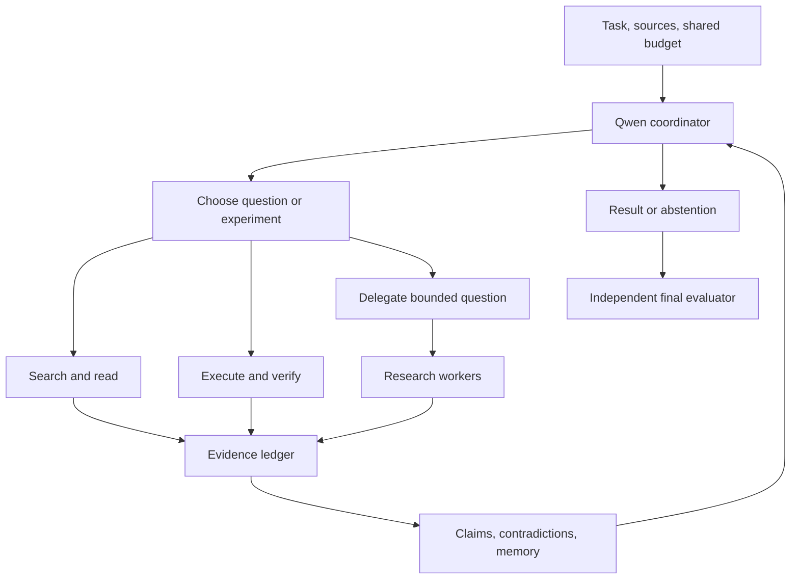

# Learning to Clarify: RL-Only Research and Development Plan

**Project:** quantum-computing-gpt

**Target:** Qwen/Qwen3.6-35B-A3B

**Revision:** 3.1 • 30 October 2026

**Status:** Proposed design; no new training or benchmark results are reported.

**Repository baseline reviewed:** [921e5440e61e8946d321015989b78ec533fe9859](https://github.com/xuda1979/quantum-computing-gpt/commit/921e5440e61e8946d321015989b78ec533fe9859)

## 1. Objective and governing decisions

**Core thesis:** carefully designed RL tasks, environments, and feedback should develop strong reusable capabilities within the chosen model's capacity and resource budget. Prioritize reasoning, insight, critical reflection, planning, accurate observation, and effective action, with detailed external knowledge available through tools.

Develop a compact scientific researcher that forms useful hypotheses, notices consequential gaps, asks the right questions, searches authoritative material, designs discriminating experiments, and revises conclusions from evidence. Qwen supplies the reasoning policy; tools, external memory, and bounded research agents extend what it can investigate.

The project's advantage should come from **research judgment and verified problem solving**. Parameters should retain mathematical foundations, scientific concepts, programming ability, and reusable investigation skills. Detailed, changing, or rarely needed information can come from external sources. Do not deliberately weaken correct knowledge or force vague answers: an already solved problem should receive a direct answer.

Human research motivates this behavior. Insight may be a useful abstraction, a missing assumption, a counterexample, a better question, or an experiment that separates competing explanations. This is an engineering analogy, not a claim of brain equivalence. Proprietary GPT/Claude model sizes and memorization capacity are not assumed.

The following decisions govern the program:

1. **All new adaptation uses reinforcement learning.** Initialize from a pinned official, already post-trained checkpoint. Add no project SFT, demonstration imitation, preference-optimization phase, teacher-logit matching, or successful-trajectory distillation. Upstream historical training is outside this restriction.
2. **Tools are part of the intended capability.** Search, reading, simulation, code/proof checking, and delegated investigation are available within explicit budgets.
3. **Learn problem selection as well as solutions.** Detect false premises, identify promising questions, and decide what evidence would change a conclusion.
4. **Compare adapter and base under identical conditions.** Match prompts, tools, sources, workers, and aggregate inference resources.
5. **Require independent evidence.** Fluent prose, high training reward, more agents, or a small internal perfect score cannot establish generalization or discovery.

Here **base** means the untouched official checkpoint used to initialize the adapter, not an arbitrary raw pretrained model. A versioned external GPT/Claude system can be a secondary reference; it cannot replace the matched Qwen comparison.

This is the governing R&D plan. The [engineering specification](Qwen36_Quantum_Posttraining_Research_Spec_EN.md) supplies verification and recovery details. Its verifier-allocation study is a separate optional factor. The existing Word specification is a historical snapshot; the current Markdown documents govern this revision.

### 1.1 Capability per unit of compute

The central design variable is the learning experience: what uncertainty the policy encounters, which observations it can obtain, what actions it can take, and which outcomes receive reliable reward. In RL, well-designed data means a distribution of tasks and interactive environments, authentic on-policy attempts, and independently checked feedback. A collection of polished answers alone does not train this program.

Aim to learn reusable procedures: infer an invariant, test an assumption, recognize a causal ambiguity, choose a useful measurement, decompose a goal, inspect a result, and change course. Store enough foundational mathematics, physics, scientific concepts, and programming knowledge in parameters to interpret evidence and detect nonsense. Retrieve long-tail facts, detailed API signatures, and changing literature as needed.

Reasoning and knowledge are coupled. Removing foundational knowledge can impair abstraction and source interpretation; RL does not provide a mechanism to allocate a fixed number of parameters exclusively to “reasoning” or prevent all memorization. “Less reliance on memorization” is a behavioral objective tested on new information and unseen families, not a claim about physically separate memory compartments.

Use the compact policy repeatedly in a closed loop:

**Observe facts → frame the problem → form alternatives → plan a discriminating action → execute → inspect the outcome → revise.**

Actions produce evidence that can improve the next decision. More internal deliberation without new evidence may fail to resolve a factual uncertainty. Tools and workers extend reach, while the core policy still needs enough competence to formulate requests, interpret results, and reject misleading feedback.

### 1.2 Use the smaller model's advantages and measure its limits

Smallness is a resource/design choice, not evidence of stronger reasoning. The following are hypotheses to test on the actual runtime.

| Potential advantage or constraint | Design response | Required measurement |
| --- | --- | --- |
| Lower actor compute may permit more useful experiments under a fixed budget | Spend any measured savings on informative rollouts, independent checks, or bounded branches | Verified progress per device-hour and total cost, including failed attempts |
| Faster or locally hosted inference may support frequent observation/action cycles | Use short decisions, targeted source inspection, and reusable execution state | End-to-end latency and throughput; tool/runtime delays remain charged |
| A reusable local policy may support several research roles | Share the frozen artifact across bounded workers and preserve independent evidence checks | Team versus single-agent quality at equal aggregate spending |
| Limited model capacity may restrict concepts, interpretation, and planning depth | Preserve foundations, scaffold learnable tasks, and diagnose oracle-evidence failures | Unaided and oracle-evidence performance on unseen families |
| Limited effective working memory may lose dependencies | Preserve evidence IDs, contradictions, subgoals, and recoverable source spans | Long-task completion, memory fidelity, and harmful-revision rate |
| Sparse active computation does not remove total weight/training-state storage | Profile the actual 35B model, adapters, caches, and optimizer | Peak memory, usable concurrency, and useful tokens per second |

Success means better scientific results per measured resource unit and reliable transfer. If extra tool calls or workers erase the expected savings, the system has not demonstrated that advantage. Frontier-model replacement and superior intelligence from small size are not assumed.

## 2. Starting point and hypotheses

### 2.1 Model and implementation inventory

The official [model card][R1] describes approximately 35B total language-model parameters and 3B activated per token, a mixture of experts, and mixed Gated DeltaNet/gated attention. Active parameters describe computation, not resident weight storage. A two-byte estimate for 35B weights alone is about 70 GB, before other components, caches, activations, optimizer state, and runtime overhead.

Pin weights, tokenizer, chat template, configuration, reasoning mode, precision, adapter targets, and runtime. Discover actual module names rather than assuming LoRA compatibility. Begin with text-only inputs.

| Component | Present capability | Gap for this plan |
| --- | --- | --- |
| [Contracts](../src/quantum_posttrain/contracts.py), [generator](../src/quantum_posttrain/generator.py), [splits](../src/quantum_posttrain/splits.py) | Exact one-qubit tasks and root-disjoint fixtures | Diverse scientific tasks and research episodes |
| [Proposal boundary](../src/quantum_posttrain/llm_boundary.py) | Model proposals cannot assign trusted labels | Research-question admission and adjudication |
| [Quantum checks](../src/quantum_posttrain/quantum.py), [contextual witness](../src/quantum_posttrain/contextual.py) | Small exact checks and a controlled-phase witness | Multi-qubit, multi-SDK, scientific-workflow coverage |
| [Qwen trainer](../src/quantum_posttrain/qwen_training.py) | Supervised LoRA | Actual RL loss, rollout groups, actor masks, full resume state |
| [Qwen rollout](../scripts/rollout_qwen.py) | One-shot execution and verification | Multi-turn research, workers, benchmark adapters |
| [Validation report](RESEARCH_VALIDATION_REPORT.md) | Historical CPU/synthetic harness checks | Measured Qwen gains, target-device RL, scientific research results |

The supervised trainer is a **legacy implementation outside this RL-only program**. Calling it or renaming its cross-entropy loss would not implement the plan. This documentation PR neither removes it nor supplies a working replacement.

The existing Qwen path handles CUDA/CPU explicitly; it is not a validated Ascend trainer. Dependency minima are not a tested environment lock. The 16 related smoke cases, synthetic 100,000-record check, and any separately reported 18/18 internal result are not external generalization evidence. Do not import measurements from another repository or an unidentified adapter.

### 2.2 Falsifiable research hypotheses

| Hypothesis | Required comparison | Rejection condition |
| --- | --- | --- |
| H1: RL improves research | RL adapter versus base in the same harness | No useful paired gain within budget |
| H2: Learning focus helps | Outcome-only RL versus focus-reward RL, matched exposure and compute | Extra data or simple focus heuristics explain the gain |
| H3: Delegation helps | Single-agent versus delegated execution for base and adapter | More worker compute yields no quality-cost advantage |
| H4: Structured memory helps | Evidence-aware memory versus equal-length summaries | Decisive evidence is lost or no tradeoff improves |
| H5: Skills generalize | External benchmarks and unseen scientific families | Gains remain confined to templates or SDK versions |

ReAct, Search-R1, DeepResearcher, and Co-Scientist establish relevant precedents [R2–R5]. The primary candidate is **RL for decision-relevant investigation**: choose questions and experiments by independently measured downstream value. Evidence-preserving memory and economical delegation are supporting studies. Search, reflection, external memory, and multiple agents alone are not novelty claims.

## 3. Observable scientific capability

| Capability | Required behavior | Evidence |
| --- | --- | --- |
| Abstraction | Identifies an invariant, assumption, limiting case, or reformulation | Better held-out predictions or simpler correct solutions |
| Question discovery | Identifies the issue that most affects the answer | Better outcomes than random or uncertainty-only focus |
| Critical and philosophical reasoning | Examines assumptions, concepts, causal claims, counterarguments, and objective tradeoffs | Valid distinctions, justified reformulations, and better decisions on unseen cases |
| Planning | Selects subgoals, dependencies, experiments, and stopping conditions | Goal completion, plan repair, and resource efficiency |
| Observation and action | Distinguishes supplied claims from measured facts and tests the environment | Authentic observations and successful actions on fresh instances |
| Hypothesis testing | Distinguishes competing explanations | A discriminating experiment and justified update |
| Evidence acquisition | Reads relevant sources and checks scope/version | Valid source-to-claim links and correct use of new facts |
| Experiment design | Chooses controls, measurements, and failure criteria | Reproducible artifacts and independent checks |
| Self-correction | Uses actual errors and counterexamples | Recovery without excessive harmful revisions |
| Agent coordination | Delegates bounded questions and checks results | Gains within the same aggregate budget |
| Stopping judgment | Answers, qualifies, or abstains appropriately | Accuracy/coverage and cost curves |

“Profound insight” is assessed by consequences, not writing style. It must expose a consequential assumption, produce a valid counterexample, improve a held-out prediction, or reduce experiment cost while retaining correctness. Open-ended originality needs blinded domain review and literature assessment. Agent agreement is not independent validation.

### 3.1 State and research actions

The policy observes

$$
s_t=(x,C_t,E_t,M_t,b_t),
$$

where \(x\) is the public task, \(C_t\) the claim/dependency ledger, \(E_t\) accessible evidence, \(M_t\) working memory, and \(b_t\) remaining shared budget. Hidden answers, evaluation tests, and privileged rubric annotations never enter this state.

Use typed actions: **OBSERVE, ASSESS, PROPOSE_QUESTION, SELECT, PLAN, SEARCH, READ, DERIVE, EXECUTE, VERIFY, DELEGATE, REVISE, COMPRESS, ANSWER, ABSTAIN**. OBSERVE requests or inspects an authentic source/measurement; PLAN specifies subgoals, dependencies, expected observations, contingencies, and budget. A proposed question identifies the affected claim, competing possibilities, a feasible observation, and why that observation matters.

The intended value of an investigation is expected improvement in independently verified final utility minus resource cost. Estimate bounded action-menu values on training roots using matched continuations. This is a proxy, not an optimality theorem. Missing information, conflicting sources, ambiguity, reasoning inability, and simulation noise require different remedies.

### 3.2 Worked example

A tentative claim says \(U\) and \(e^{i\phi}U\) are interchangeable because global phase is unobservable. The task composes them under coherent control. The useful question is whether standalone equivalence survives that composition.

For \(U=I\), controlled-\(e^{i\phi}I\) changes the relative phase of a control in \(|+\rangle\), giving \(\langle X\rangle=\cos\phi\); controlled-\(I\) gives \(1\). The policy should choose this witness, revise its assumption, and state when substitution is valid. This is an analytic example, not a trained-model discovery. Hold out different composition families to test judgment.

## 4. Research agents, evidence, and memory

### 4.1 Bounded delegation

Establish a single-agent result first. Then add a coordinator and at most three role-prompted workers: literature investigator, experiment/code investigator, and skeptical reviewer. These are roles, not assumed specialist capabilities.

A delegation packet includes the question, public context/evidence IDs, expected artifact, tools, allocated budget, stop condition, and parent episode ID. Workers return claims, sources/artifact hashes, executed checks, limits, and unresolved alternatives. The coordinator checks consequential results. No recursive worker spawning occurs initially.

Start RL with a trainable coordinator and fixed workers shared by candidate and control. Worker text is an observation, not an imitation target. Later shared-policy training requires every actor's token ownership, behavior probabilities, revision, and trajectory to be recorded. Never treat stale or foreign-worker tokens as on-policy actor samples.

The primary all-role system comparison uses the same frozen base or adapter revision in every role. Stronger external workers are a separately labeled experiment. Charge all workers, failures, messages, summaries, tools, and verification to one episode budget. Parallelism can reduce latency but does not make compute free.

### 4.2 Evidence and memory contracts

| Memory | Content | Update boundary |
| --- | --- | --- |
| Parameters/adapter | Foundations and investigation policy | Offline versioned RL |
| Working memory | Hypotheses, assumptions, dependencies, contradictions, evidence IDs | Bounded within one episode |
| External memory | Versioned sources and independently checked findings | Admission gates; read-only during primary testing |

Keep append-only events and content-addressed artifacts. Sources record URI, revision, retrieval time, exact span/hash, and scope. Experiments record code/config/data hashes, environment, seeds, raw results, and verdict. An API document does not certify generated code.

Separate model confidence from authenticated verification. Preserve contradictions and superseded claims. Compression retains unresolved obligations and recoverable evidence pointers. A vector hit or a vote among agents is not a truth label.

Retrieved text and worker output cannot change task rules, rewards, budgets, or permissions. Candidate execution cannot read gold programs or evaluator secrets. No weights or cross-task persistent memories are updated during primary evaluation; continual learning needs a separate chronological study.

## 5. RL tasks and data generation

### 5.1 Problem ownership and diversity

The harness owns roots, contracts, splits, rewards, and adjudication, following the [problem/rollout boundary](PROBLEM_AND_ROLLOUT_BOUNDARY.md). LLMs and agents may propose questions, variants, hypotheses, and solutions. Acceptance requires provenance, meaningful information need, a checkable contract, and semantic review where necessary.

A task record contains a public problem, permitted environment, completion criteria, evaluator reference, and lineage. Reference solutions are not policy-loss targets. Rollout trajectories come from the current behavior policy. Teachers may help construct environments or private rubrics; their traces, answers, and logits are not imitated.

Include six information-need strata: direct-solvable tasks; one missing fact; multiple dependent gaps; contradictions/false premises; research-to-code; insufficient information. Add problem-discovery tasks where an attractive research agenda contains a decisive flaw. Judge proposed questions by held-out experimental value, not resemblance to a teacher's phrasing.

Cover algorithm families, qubit counts, noise models, assumptions, SDKs, versions, debugging failures, and research workflows. Random parameter changes alone do not establish structural diversity.

### 5.2 Initial mixture

Assign each task one primary bucket so percentages do not double count. These are proposed RL sampling shares.

| Bucket | Share | Examples |
| --- | ---: | --- |
| Quantum coding/simulation | 30% | Multi-SDK synthesis, compilation, version-aware repair |
| Quantum science/theory | 25% | Channels, QEC subproblems, checked counterexamples |
| Agentic research workflows | 15% | Question selection, experiments, data/repository analysis |
| General mathematics/physics | 15% | Exact, symbolic, numerical reasoning and boundary cases |
| General software engineering | 10% | Algorithms, scientific Python, debugging |
| Instruction/tool contracts | 5% | Machine-checked constraints and valid actions |

Every bucket uses RL. Retention means verifiable general tasks and an explicit reference-policy regularizer, not demonstration replay with next-token loss. Change the mixture only from development coverage and retention evidence. Domain concentration does not by itself prove inevitable expert collapse.

### 5.3 Learnability without SFT

Measure base success and tool compliance. Begin with short, solvable tasks and trusted outcomes, then extend to repairs, dependent searches, experiments, and delegation.

A development diagnostic may sample 16 attempts per training root and inspect roots with roughly 2–12 successes. This is a bounded heuristic, not a permanent filter. Preserve easy, hard, negative-premise, and abstention families in a fixed diagnostic stream.

If all attempts fail, distinguish invalid tasks, API/environment mismatch, missing sources, parser failure, and reasoning difficulty. Simplify the training task, expose a valid public API contract, or decompose it into checkable subproblems. Record hints and withdraw them progressively. Test prompts stay unchanged. If learnability still fails, stop that branch and report the limit; do not silently add SFT.

Pass@G equal to one means at least one success, not all G successes. Only **constant total rewards** imply zero centered policy-reward advantage. All-pass/all-fail groups can retain signal from other declared reward components. Cost variation among failed episodes is not evidence of learning to solve the task; track verified-success support separately.

### 5.4 Splits and initial quantities

Split source families, theorem/algorithm roots, generator ancestry, witness schemas, and document versions before producing paraphrases, translations, trajectories, summaries, or caches. Quarantine derivatives together. Benchmark solutions, hidden checks, target papers, teacher completions, and previous test logs never enter test-time retrieval.

Provisional unbuilt targets are 120 development pilot roots; 2,000 reviewed training roots; 300 disjoint development/calibration roots; and 1,200 private sealed research roots, initially 200 per information-need stratum. A focus pilot uses 200 training states with three candidate investigations each. Adjust final counts using development-only power and cost estimates.

Independent roots/source families, not paraphrase counts, determine sample size. Public benchmark roots remain evaluation-only. Pretraining contamination is unknown; paired base/adapter comparisons do not remove it.

Add new-information tasks using evaluator-authored conventions, APIs, or synthetic scientific worlds created after model freeze. Compare source-present, source-withheld, and misleading-source conditions. This tests evidence use without claiming all public facts are unseen.

### 5.5 Discovery environments from the second reference

These are task/environment designs for on-policy RL, not supervised target traces.

| Archetype | Public actor input | Independent reward/evaluation |
| --- | --- | --- |
| Retrospective reconstruction | Authorized pre-publication sources and an unresolved tension | Valid mechanism/predictions, source fidelity, private checked obligations |
| Anomaly and no-go analysis | Baseline, explicit assumptions, actual failure diagnostics | Correct root cause and a valid proposal under clearly amended assumptions |
| Cross-domain transfer | A solved mechanism in A and a precisely stated problem in B | A checked mapping, preserved conditions, and executable or formal consequences |
| Failure → refutation → pivot | Current hypothesis and authentic counterexample/experiment | Justified revision and success on new cases |

A proposed “loophole” cannot refute a theorem while retaining all its assumptions. If an assumption changes, state the new problem and resource tradeoff. A cross-domain analogy is not an isomorphism until the mapping and relevant structure are checked.

For retrospective tasks, a teacher may inspect a training-only target paper to propose a private provenance anchor: source roles, synthesis bridge, assumptions, and checkable obligations. The actor receives only authorized precursor evidence. Target-specific anchors, titles, abstracts, future terminology, citations, retrieval hits, and summaries must be audited for leakage. Removing an anchor after generating a privileged trace would not make that trace an unbiased on-policy sample; do not train on it.

IdeaAnchor and Reconstruction are relevant prior work [R12, R13]. Historical reconstruction measures recovery under a restricted context, not new discovery; anonymization and time cutoffs cannot erase pretraining knowledge. Use controlled new-information tasks and independent checks alongside any retrospective score. A hidden rubric is fallible: it can reward agreement with one known solution and reject a different valid idea.

Add two bounded generation loops:

- **Adversarial proposal and critique:** generate a small fixed candidate menu, ask a skeptic to seek counterexamples with actual tools, and rerun survivors on independent cases. Tournament rank is a selection heuristic, not truth or reward ground truth.
- **Evolutionary program search:** record parent/child code, mutations, seeds, metric, and independent reevaluation [R14, R15]. Preserve failures as well as improvements. Introduce useful parents as public task baselines for fresh on-policy RL; do not imitate elite code or explanatory traces.

A jump selected from thousands of mutations may be noise or evaluator overfitting. Reevaluate improvements on fresh seeds, held-out instances, and a frozen baseline before using them as positive evidence. Charge all proposals, critiques, searches, and rejected mutations to data-generation cost. Begin with a reviewed pilot, not a promise of tens of thousands of profound insights.

### 5.6 Deliberately design experiences for the desired capabilities

Generate families around a specific capability and its characteristic failure mode. Preserve a valid independent oracle or adjudication procedure for each admitted task.

| Capability | Task/environment construction | Reward or evaluation evidence |
| --- | --- | --- |
| Reasoning and abstraction | Vary surface notation, parameters, representation, and domain while preserving a checked relation | Correct transfer to held-out structures; valid derivations and counterexamples |
| Insight and question framing | Supply competing explanations or an attractive objective with a consequential hidden assumption | A useful reformulation or discriminating question improves a held-out outcome |
| Critical/philosophical judgment | Include ambiguous definitions, invalid causal inference, incompatible assumptions, or competing explicit goals | Correctly identifies the ambiguity/assumption and makes a justified scoped decision |
| Planning | Use environments with dependencies, delayed outcomes, budgets, and feasible alternative plans | Independent goal completion, efficient sequencing, and recovery when a prerequisite changes |
| Observation | Supply incomplete, stale, or conflicting descriptions alongside authentic inspectable state | Uses the actual measurement/source, preserves uncertainty, and detects planted contradictions |
| Action and revision | Return genuine execution feedback; introduce controlled disturbances requiring a new action | Repairs the plan and succeeds on fresh conditions without falsifying observations |
| Knowledge acquisition | Define a new coherent API/convention only in permitted documents | Correct evidence use and adaptation when the decisive documented fact changes |

“Philosophical” does not mean rewarding impressive essays, a particular worldview, or agreement with a teacher. Operational targets include conceptual precision, valid inference, explicit assumptions, epistemic humility, falsifiability, and reasoning about stated goals/tradeoffs. Use checkable cases where possible and separate blinded expert assessments where judgments remain open.

Construct paired interventions. Hold wording/style fixed while changing one decisive fact, assumption, constraint, or tool outcome; the correct action should change. Also change surface wording while preserving the underlying relation; the correct decision should remain stable. Keep both kinds of pair within one root and one split. These controls distinguish sensitivity to evidence from memorized phrases.

Retain each task's intended skill, controlled intervention, prerequisites, authentic observation/action log, expected behavioral consequence, and independent scoring contract. Policy records can be concise beliefs, plans, checks, and revisions; no inaccessible private reasoning trace is required. An RL attempt remains sampled from the behavior policy, including failed actions.

Add a fixed diagnostic stream spanning all capabilities. A task generator that optimizes only for immediate reward may neglect foundations, difficult plans, or uncommon valid strategies. Audit learnability, structural diversity, observation fidelity, label/verifier quality, and learning signal per family before expanding volume.

## 6. RL-only training sequence

### 6.1 Stage A: baseline and lifecycle

Run untouched Qwen in direct, one-pass retrieval, and prompted single-agent modes on development roots. Add oracle-evidence diagnostics using the necessary permitted passages. Failure even with oracle evidence indicates an interpretation or reasoning bottleneck.

Freeze base weights. Initialize LoRA so the initial policy matches base within a measured numerical tolerance; verify trainable modules and a reference policy with no active adapter. Pass load → rollout → reward → loss → backward → update → checkpoint → fresh-process resume → evaluate, first on a tiny fixture and then the target runtime. Independently audit rewards, masks, probabilities, KL, and parameter movement.

### 6.2 Stage B: short-horizon RL cold start

Begin synchronized with group size 4, one update per complete group, short episodes, discovered attention-projection LoRA targets, and frozen router/base weights. Rank 8/16 and a small development-selected learning-rate grid are candidates, not optima.

Learn valid actions, small derivations/circuits, use of authentic diagnostics, and stopping through reward. No supervised warmup occurs. Keep successful and unsuccessful on-policy samples.

Here SAPO means **Soft Adaptive Policy Optimization**, not another method sharing the acronym [R6]. Reproduce a transparent point-reward clipped control, then compare SAPO from the same checkpoint with matched roots, sampling law, reward, updates, and evaluation. Pin exact equations, normalization, reference KL, and code revision. Neither optimizer is assumed to win.

The SAPO paper reports temperatures 1.0/1.05 in a controlled experiment. The reference's 0.1/0.25 values and creativity-specific settings are unvalidated candidates with potentially different conventions. Smooth gating cannot repair mismatched tokenization, stale policies, or incorrect recurrent-state handling.

### 6.3 Stage C: outcome-based research RL

Extend to search, reading, experiments, repairs, and evidence-linked revision. The episode is the reward unit. Initially train on independently adjudicable tasks; open research remains evaluation until reward reliability is established.

For an infrastructure-valid episode the pilot reward is

$$
R_i=Y_i-0.05C_i-0.05F_i,
$$

where \(Y_i\in\{0,1\}\) is checked contract success, \(C_i\in[0,1]\) is normalized total resource use, and \(F_i\in[0,1]\) is the fraction of asserted evidence links proven fabricated. Freeze cost weights/denominators from development. Mandatory evidence is part of success.

Success scores at least 0.90; failure at most zero. Severe permission/provenance violations have a separately declared invalid-action penalty. Infrastructure failures have no invented numeric reward. Abstention fails on answerable tasks and may succeed on adjudicated insufficient-information tasks; report those strata separately.

No bonus is given for verbosity, confidence, queries, worker count, or agreement. Begin with terminal reward; shaping requires a new contract and ablation. Do not repeat final success at every turn.

For the clipped control let \(A_i=R_i-\bar R\), without group-standard-deviation scaling, and

$$
J(\theta)=\frac1G\sum_i\frac1{N_i}\sum_{k\in\mathcal A_i}
\min\left(\rho_{ik}A_i,
\operatorname{clip}(\rho_{ik},1-\epsilon,1+\epsilon)A_i\right)
-\beta K_{\rm ref}.
$$

\(\mathcal A_i\) contains actor-generated tokens, \(N_i>0\), and \(\rho_{ik}\) uses the recorded behavior distribution at the actual history. \(K_{\rm ref}\) is full-vocabulary current-to-frozen-base KL averaged over the same eligible histories, or an explicitly versioned and independently checked estimator. Rewards and behavior quantities are detached. Compare length bias before changing this episode normalization.

Prompt, retrieved, tool, padding, and foreign-worker tokens remain context but are masked from actor loss. Masking does not prevent privileged-input leakage. Test masks with sentinel tokens and independent span counting.

For the first probability audit use temperature 1, no truncated top-k/top-p sampling, and no repetition penalty. Any later transform must define behavior support and importance ratios. At identical weights, trainer and rollout log probabilities must agree within a predeclared tolerance, including tokenization, precision, cache/recurrent-state resets, and history.

Keep complete groups and all failed members. Record constant-reward groups, truncation, parse failures, policy lag, and cancellation. Constant rewards give zero policy-reward advantage, while KL can still produce gradients. Bound resampling instead of looping until a mixed group appears.

### 6.4 Stage D: focus and question-selection RL

At a training-only state compare three feasible investigations, including answer-now or abstain where appropriate. Fork immutable public state; pair continuation seeds where feasible and use a fixed continuation policy and matched remaining budget. Independently score final utility and total branch cost.

Use branch outcomes to estimate action advantages for an **RL SELECT update**, recording behavior probabilities and the estimator. For the pilot, present the same finite action menu, estimate each action's continuation utility with disjoint paired samples, sample SELECT from the recorded behavior distribution, and center its estimated utility against that distribution's mean. Apply the declared policy-gradient/importance-ratio objective to the sampled SELECT action only; unchosen branch tokens are not on-policy actor samples. Do not turn the winner into a cross-entropy target, preference pair, or teacher trajectory. Keep ties/unresolved comparisons explicit. Use disjoint training folds for fitted baselines where necessary.

The nearest control receives the same roots, branch exposure, final outcomes, updates, and aggregate generation/verifier budget without action-specific focus rewards. Add random, uncertainty-only, and cheapest-first selection. Charge every discarded branch. Estimated value is relative to the menu and continuation policy, not globally optimal research.

Question discovery is evaluated before privileged witnesses are shown. Teacher-generated questions alone do not demonstrate that the learner can find the right problem.

### 6.5 Stage E: delegation, memory, and calibration

After single-agent gains, train the coordinator to allocate bounded work to fixed workers, request falsifying checks, reconcile evidence, and avoid redundant delegation. Use final utility under the shared budget.

Test structured memory against equally sized generic summaries. Calibrate confidence using a frozen post-hoc mapping on development-calibration roots; this is not language-model SFT. Admit reusable verified findings to external memory only between versioned runs.

No imitation or distillation phase follows RL. Tool-disabled evaluation of the same adapter is a diagnostic; zero-tool memorization is not the deployment objective.

### 6.6 Separate discovery-reward experiment

Binary success remains the initial reliable control. For optimization tasks, add a separate **validity-gated baseline-improvement** contract. Display a reproducible feasible baseline, pin its metric/resources, and state all semantic constraints.

Let \(d=1\) for a metric to maximize and \(d=-1\) for one to minimize, \(\Delta_i=d(m_i-m_0)\), and let \(\Delta_{\rm target}>0\) be fixed on development data. One proposed bounded reward is

$$
R_i=
\begin{cases}
-1,&\text{invalid candidate},\\
\operatorname{clip}(\Delta_i/\Delta_{\rm target},0,1)-0.05C_i,
&\text{valid candidate}.
\end{cases}
$$

Missing/failed measurement remains VOID, not invalid or zero. An inconclusive noisy improvement needs additional adjudication before assigning a numeric reward. Validity includes public fidelity/accuracy constraints, feasible resources, and independent execution. Report regressions even when clipped to zero improvement. Evaluate on fresh seeds/instances to avoid rewarding benchmark overfitting.

For gate count, latency, and error rate, lower is better; do not use an unsigned “candidate minus baseline” formula. Freeze metric direction, denominators, caps, noise thresholds, and cost weights. Never weaken correctness to buy an apparent optimization gain.

A private provenance rubric may judge a theoretical training task only after reliability, alternative-valid-solution handling, and blind expert agreement are demonstrated. Anchors are evaluator inputs, not proof of truth or immunity to reward hacking. Keep exact/verifiable and judge-dependent results separate.

Diversity is initially a proposal-selection diagnostic. Canonicalize AST/mechanism representations and manually inspect whether differences are substantive. Do not reward unusual language or invalid ideas. A group-relative uniqueness reward couples candidates and changes the objective; do not plug it into ordinary independent-return GRPO/SAPO without a defined joint estimator and tests. Any later bounded diversity bonus requires its own matched experiment and a validity gate.

## 7. Trusted verification

| Track | Accepted evidence | Limit |
| --- | --- | --- |
| Formal/symbolic | Accepted proof under explicit assumptions; checked finite identities | CAS agreement or a weaker formal statement does not prove the original claim |
| Numerical/quantum | Exact small systems, certified bounds, powered tests | Random examples cannot prove a general theorem |
| SDK/software | Hidden functional tests and circuit semantics | Import/execution success alone is insufficient |
| Scientific workflow | Reproduced result, held-out prediction, tested hypothesis | A plausible report or invented run is not success |
| Open research | Blinded review, artifacts, literature assessment | Judge scores alone cannot establish discovery |

Use independent implementations/backends for critical oracles. Validate positive, negative, metamorphic, contextual, and tamper fixtures. Stochastic tests need tolerance, shots, seeds, confidence, and power; non-rejection is not equivalence.

Guard against hardcoding, forbidden classical shortcuts, verifier modification, and fabricated citations/results. An AST blacklist alone is insufficient; public contracts, isolation, and semantic checks govern. Legitimate classical preprocessing remains allowed where specified. Stabilizer simulation cannot directly validate arbitrary non-Clifford protocols. Admit only scientifically feasible tasks with appropriate checks.

## 8. Adapter-versus-base benchmark suite

### 8.1 Named suites

These are selected evaluations, not downloaded assets or completed runs. Pin actual releases/commits, task IDs, scorers, terms, dependency locks, and images before execution.

| Suite | Purpose | Protocol |
| --- | --- | --- |
| [Qiskit HumanEval][R7] | External quantum coding | Native functional Pass@1. Upstream describes 151 tasks. Standard and hard variants share roots; report separately, not as 302 independent tasks. |
| [QHackBench][R8] | PennyLane generalization | Pinned official tasks/checker; success by difficulty. Separate syntax/execution from correctness; verify obtainable artifacts and terms. |
| [ScienceAgentBench][R9] | Executable scientific workflows | Official evaluation/settings, completion and cost. Supplement judge-dependent parts with artifact checks/blind review. |
| [LiveCodeBench][R10] | General coding retention | Frozen release/date window and original code-generation Pass@1. A recent window alone does not establish no pretraining exposure. |
| [IFEval][R11] | Instruction retention | Pinned official strict prompt/instruction scores, no added tools. |
| Private clarification/research suite | Focus, new information, experiments | Root-disjoint sealed contracts and independent success checks |
| [Reconstruction][R13], optional | Literature-based idea recovery | Pinned blind protocol if validated assets are available; report as retrospective recovery, with judge and contamination limitations |

Keep native scores separate from tool-enabled adaptations. Use the frozen reference SDK for official Qiskit scoring; a modern-SDK stress variant is a distinct track. Never silently change tests or tolerances.

Honor ScienceAgentBench's restriction on redistributing unzipped evaluation assets. Gold programs, evaluator rubrics/scripts, and hidden checks remain outside the actor filesystem. If assets/protocols cannot be validated, mark UNKNOWN and predeclare any replacement before training/model selection. A missing cell cannot become a fabricated substitute score.

Public suites may overlap pretraining. Paired base/adapter results establish incremental performance under the protocol, not new discovery. Private new-information/source-disjoint tasks provide complementary evidence.

### 8.2 Required comparison matrix

| Setting | Untouched base | RL adapter | Isolates |
| --- | --- | --- | --- |
| D: direct, no tools | B-D | A-D | Unaided competence/retention |
| R: identical one-pass retrieval | B-R | A-R | Use of the same external evidence |
| S: same single-agent harness | B-S | A-S | Adapter effect in iterative research |
| M: same coordinator/workers | B-M | A-M | Adapter effect with delegation |
| O: oracle permitted evidence | B-O | A-O | Interpretation versus retrieval bottlenecks |

Run this matrix on the private suite. Use native public benchmark conditions first; selected tool variants are additional labeled tracks. Distinguish coordinator-only fixed-worker adaptation from all-role adaptation.

Within each pair match templates/prompts, reasoning mode, context, corpus/index, worker count, diagnostics, decoding, stop rules, aggregate generation/input tokens, tool calls, wall-time and compute caps. Give base prompting comparable development tuning effort. Reset caches, workspaces, and external memory per episode; randomize pair order. Report realized spending and quality-cost curves, not just equal caps.

Authenticate weights and adapter activation with manifests/startup checks. Record paths/hashes, trainable targets, and endpoint-to-artifact mapping. Adapter-disabled fresh loads should reproduce base within a declared numerical tolerance. Missing or ignored adapters invalidate comparisons.

Also compare focus-trained and outcome-only RL adapters at matched data and training cost. No new SFT comparator is trained. A versioned GPT/Claude system may be an external practical reference with exact date, tools, and cost disclosed.

### 8.3 Scientific and operational metrics

Measure final verified success, functional Pass@1, family scores, and success versus token/call/time/device-hour budgets. Score the initial response before tools independently to measure recovery and harmful revision.

Additional metrics are question utility, bounded-menu focus regret, valid counterexamples, discriminating experiments, assumption identification, evidence precision/coverage, fabricated evidence, Brier score, risk at matched coverage, appropriate/false abstention, memory fidelity, stale-source robustness, worker recovery, and delegation overhead.

Open research receives a separate blinded rubric for validity, question importance, reproducibility, evidence, and originality relative to inspected literature. Report reviewer agreement and artifacts. Do not merge fluent judge ratings into executable correctness.

### 8.4 Test whether data design produces reusable capability

Add prespecified diagnostics to the existing paired base/adapter evaluation; they do not replace the co-primary endpoints or create an unvalidated aggregate “intelligence score.”

- **Knowledge access versus reasoning:** compare direct, oracle-evidence, and ordinary retrieval conditions. If the correct passage is available but the model cannot reason with it, more search alone has not solved the problem.
- **Evidence sensitivity:** use new-information and controlled-intervention pairs. Measure whether a changed fact produces the correct changed plan/action, and whether irrelevant wording leaves the decision stable.
- **Planning and action:** score actual environment goals, violated constraints, recovery, and resources. A plausible plan without execution does not establish action competence.
- **Critical judgment:** evaluate false-premise detection, causal counterexamples, ambiguity handling, and goal tradeoffs with independent case-specific criteria. Keep open philosophical judgments separate.
- **Data-design value:** compare deliberate capability-targeted task families with an admissible generic task mixture under matched initial model, unique-root count, source access, generated/updated tokens, verifier cost, and training budget. Separately vary structural diversity and update count; do not attribute a larger or more expensive run's gains solely to “better data.”

Give controls comparable development tuning. Freeze diagnostic families and analysis before testing, report per-capability uncertainty and retention, and label underpowered studies exploratory. Use measured quality-cost curves to decide whether repeated research actions exploit the smaller actor's resource profile. A claim specifically attributable to model size also needs a pinned larger model with disclosed architecture/size under the same harness and resource accounting; a same-size base/adapter pair alone cannot isolate a size effect.

## 9. Statistics, falsification, and promotion

Freeze task IDs, counts, metrics, checkpoint selection, thresholds, and analysis before sealed testing. Select checkpoints only on development data. Test results must not guide curriculum tuning.

Proposed co-primary endpoints are:

1. Quantum external code score \(Q=0.5Q_{\rm Qiskit}+0.5Q_{\rm QHack}\), with prespecified family/difficulty weights and both suites measured.
2. Private answerable research score \(S\), macro-averaged across the first five information-need strata. Insufficient-information tasks are a separate abstention guardrail.

The main research comparison is A-S versus B-S. For Q this uses a frozen tool-enabled adaptation with unchanged final functional checks, reported separately from official native D scores. Private S uses its frozen research protocol. Tools cannot see official hidden tests or answers.

For each endpoint derive the practical target from its independent development pilot:

$$
\delta_{\min}=\min(0.10,\;0.20(1-S_{\rm base,dev})).
$$

Substitute the relevant endpoint in this formula. At ceiling, redesign/reseal before testing. Proposed acceptance requires at least this point gain and a positive paired lower confidence bound. Account for both endpoints, for example with prespecified 97.5% two-sided Bonferroni-adjusted intervals. Report each suite; aggregate gains cannot hide a substantial SDK regression.

Resample paired roots/source-family clusters, preserving standard/hard dependence. Use three independent training seeds for candidate and nearest RL control before claiming stable training benefit; retain all seeds and use a prespecified analysis of seed/root variation. One run is a pilot. Set sample size by development-only power analysis; repeated variants do not solve low power.

For proposed two-percentage-point retention margins, require the lower confidence bound of adapter-minus-base to exceed -0.02, with multiplicity handled in advance. A point estimate within the margin is insufficient. Include exact mathematics/physics holdouts with the coding/instruction guardrails.

Stochastic Pass@1 needs a frozen sample/seed list and estimates single-attempt success; report deterministic first attempts separately. Pass@k needs actual n ≥ k samples and the proper estimator. Research retries consume the episode budget.

Malformed outputs, candidate-caused timeouts, invalid actions, and answerable-task abstentions fail. Retry authenticated infrastructure faults only under the same fixed policy, retaining all spending. Reconcile every task: PASS/FAIL measured, VOID invalid measurement, UNKNOWN missing evidence. Report conservative bounds and withhold promotion when missing cells could reverse the decision.

Essential controls remove focus rewards while matching branch exposure; use random/uncertainty/cheapest focus; supply oracle passages; withhold/corrupt decisive evidence; replace structured memory with equal-length summaries; remove delegation at matched compute; hold out SDK conventions/source families; and disable adapter/tools. Discovery-reward studies additionally compare binary reward, baseline-delta reward, and any validated diversity/rubric branch under matched search budgets.

If the candidate fails the nearest valid control, retain the simpler system and report the negative or narrower result.

## 10. Resources and recovery

### 10.1 Proposed episode profiles

| Resource, shared across agents | Short research | Long scientific workflow |
| --- | ---: | ---: |
| External calls | 8 | 32 |
| Generated tokens | 8,192 | 32,768 |
| Observation tokens | 16,384 | 65,536 |
| Aggregate processed input tokens | 131,072 | 524,288 |
| Active context/call, including generation headroom | 16,384 | 32,768 |
| Wall time | 180 seconds | 1,800 seconds |
| Concurrent workers | At most 2 | At most 3 |
| Delegation depth | 1 | 1 |

These are unvalidated development starting caps. Re-reading, summaries, failures, and duplicated work count. Report profiles separately. Native benchmark limits take precedence for official scores.

### 10.2 MoE and target-runtime gates

Inspect available hardware; lock the actual driver/CANN/torch-npu or CUDA environment, distributed backend, rollout engine, trainer, and PEFT/kernel integration. Inference support does not prove training support; historical device capacity is not current availability.

Measure trainer/rollout probability agreement, recurrent/cache resets, gradients, memory, throughput, routing/entropy diagnostics, and fresh reload. Begin with attention LoRA and frozen router/base. Expert adapters, full-parameter RL, load-balancing changes, 16k–32k exploration, and asynchronous rollout require separate compatibility, cost, and retention evidence. Do not assume weight fit implies training fit or that generic MoE claims justify changing router losses.

Provisional ceilings are 24 device-hours for preflight/canary, 128 for short-horizon RL, 256 for research pilots, and 128 for bounded evaluation. They are planning stop budgets, not runtime estimates or launches in this PR. Include worker/branch generation, indexing, verification, failures, and evaluation. Multi-seed publication experiments need measured cost estimates first.

### 10.3 Resume and stop conditions

Record run/model/adapter/config/data/scorer hashes, environment, seeds, behavior revisions, complete/consumed groups, budgets, and parent checkpoint. Atomically save adapter, optimizer, scheduler, RNG, sampler/cursor, and rollout-consumption state. Prove fresh-process resume and no duplicate training on consumed groups.

Persist tool observations by action ID; inspect an existing remote job before relaunching after disconnection. Use bounded retries and preserve job/checkpoint identity. Budget exhaustion returns partial artifacts and unresolved obligations.

Monitor loss/gradients, updates, KL/ratios, zero-signal groups, entropy, tool validity, family coverage, truncation/lag, memory/cost, and reward-versus-independent-score gaps. Pause on leakage, corrupt evidence, ratio mismatch, nonfinite loss, repeated loops, exhausted budget, or failed retention. Three planned development evaluations without useful gain trigger diagnosis of coverage, reward, runtime, and learnability before more steps.

## 11. Implementation roadmap and completion

All packages are planned; none is asserted implemented by this document.

| Package | Dependency | Deliverable | Exit evidence |
| --- | --- | --- | --- |
| P0: inventory/freeze | Audit | Identity/runtime manifests, development protocol, budgets | Actual availability and known limits |
| P1: research contracts | P0 | Episodes, ledgers, isolated tools, replay | Malformed/forged evidence rejected |
| P2: data/baselines | P1 | Capability/intervention matrix, splits, 120-root pilot, D/R/S/O runs | Independent contracts, learnability and coverage audits, complete records |
| P3: RL lifecycle | P2 | Group rollout, actor masks, objective, LoRA resume | Independent loss/KL and target-device canary |
| P4: research RL | P3 | Outcome RL and retention mix | Paired development gain or rejection |
| P5: focus/discovery RL | P4 | Branch runner, SELECT RL, discovery environments | Matched-exposure controls and useful-question evidence |
| P6: agents/memory | P4; P5 optional | Bounded workers, shared accounting, evidence memory | Delegation and memory ablations |
| P7: sealed evaluation | Frozen candidates | Public/private outputs and analysis | Complete counts, uncertainty, decision |

Add versioned research records alongside the strict one-qubit Task. Proposed modules include `episodes.py`, `evidence.py`, `tools.py`, `runner.py`, `focus_rl.py`, `delegation.py`, and `evaluation.py`; these are not implemented APIs.

Quantum contracts, verifiers, and learning objectives stay in this repository. Future-Code remains the project-neutral platform for jobs, dependencies, evidence, budgets, and recovery.

The first operational milestone is a bounded prompted loop with authentic evidence and base comparisons. The first training milestone is a resumable RL adapter with an independently checked update. Neither proves efficacy.

Full completion requires a loadable adapter/manifests, lawful source/task lineage, target-runtime lifecycle, authenticated base/adapter evaluation, nearest RL controls, generalization/retention evidence, full cost/uncertainty, failure analysis, and a model/system card. Scientific discoveries require independent validation of the actual result.

## 12. Decisions on the supplied references

| Suggestion | Decision |
| --- | --- |
| SFT, self-distillation, elite-trace imitation | Excluded; task construction and on-policy RL only |
| SAPO and fixed “creative” temperatures | Reproduce exact conventions; compare on development data without guaranteed benefit |
| Medium-pass-rate filtering | Bounded diagnostic with easy/hard/family monitoring |
| General/quantum mixture | Initial RL sampling hypothesis plus retention gates |
| Privileged provenance anchors | Evaluator-only training signal after leakage and reliability audits |
| Pre-publication reconstruction | Retrospective diagnostic, not evidence of genuinely new discovery |
| Multi-agent tournaments | Budgeted candidate selection followed by independent verification |
| Evolutionary lineage harvesting | Public baselines/environments for fresh RL, not supervised elite targets |
| Baseline-delta reward | Separate validity-gated contract with metric direction, noise, and fresh-case checks |
| Diversity multiplier | Defer training until its group-coupled objective/estimator is validated |
| “No-go bypass” and cross-domain isomorphism | Explicit changed assumptions and checked mappings; no implied theorem violation |
| Claimed universal breakthrough rates/collapse guarantees | Do not import as project evidence or expected outcomes |

## References

Primary sources for factual scope and prior-art positioning, checked 30 October 2026. Budgets, mixtures, and acceptance targets are proposed project decisions. Optional sources/assets still need version and protocol validation before experiments.

- [R1] Qwen. [Official model card](https://huggingface.co/Qwen/Qwen3.6-35B-A3B).
- [R2] Yao et al. [ReAct](https://arxiv.org/abs/2210.03629).
- [R3] Jin et al. [Search-R1](https://arxiv.org/abs/2503.09516).
- [R4] Zheng et al. [DeepResearcher](https://arxiv.org/abs/2504.03160).
- [R5] Gottweis et al. [Co-Scientist](https://arxiv.org/abs/2502.18864).
- [R6] Gao et al. [Soft Adaptive Policy Optimization](https://arxiv.org/abs/2511.20347), [v2 equations](https://arxiv.org/html/2511.20347v2).
- [R7] Qiskit community. [Qiskit HumanEval](https://github.com/qiskit-community/qiskit-human-eval); [paper](https://arxiv.org/abs/2406.14712).
- [R8] Basit et al. [QHackBench](https://arxiv.org/abs/2506.20008).
- [R9] OSU NLP Group. [ScienceAgentBench](https://github.com/OSU-NLP-Group/ScienceAgentBench).
- [R10] LiveCodeBench authors. [Official repository](https://github.com/LiveCodeBench/LiveCodeBench).
- [R11] Zhou et al. [IFEval](https://arxiv.org/abs/2311.07911).
- [R12] Chen et al. [IdeaAnchor](https://arxiv.org/abs/2610.08781). Its demonstration/distillation phases are not adopted.
- [R13] Chen et al. [Reconstruction](https://arxiv.org/abs/2608.16645). Optional protocol/asset review required; the supplied match-rate claims are not project evidence.
- [R14] Romera-Paredes et al. [FunSearch](https://doi.org/10.1038/s41586-023-06924-6).
- [R15] Novikov et al. [AlphaEvolve](https://arxiv.org/abs/2506.13131).

[R1]: https://huggingface.co/Qwen/Qwen3.6-35B-A3B
[R2]: https://arxiv.org/abs/2210.03629
[R3]: https://arxiv.org/abs/2503.09516
[R4]: https://arxiv.org/abs/2504.03160
[R5]: https://arxiv.org/abs/2502.18864
[R6]: https://arxiv.org/abs/2511.20347
[R7]: https://github.com/qiskit-community/qiskit-human-eval
[R8]: https://arxiv.org/abs/2506.20008
[R9]: https://github.com/OSU-NLP-Group/ScienceAgentBench
[R10]: https://github.com/LiveCodeBench/LiveCodeBench
[R11]: https://arxiv.org/abs/2311.07911
[R12]: https://arxiv.org/abs/2610.08781
[R13]: https://arxiv.org/abs/2608.16645
[R14]: https://doi.org/10.1038/s41586-023-06924-6
[R15]: https://arxiv.org/abs/2506.13131
