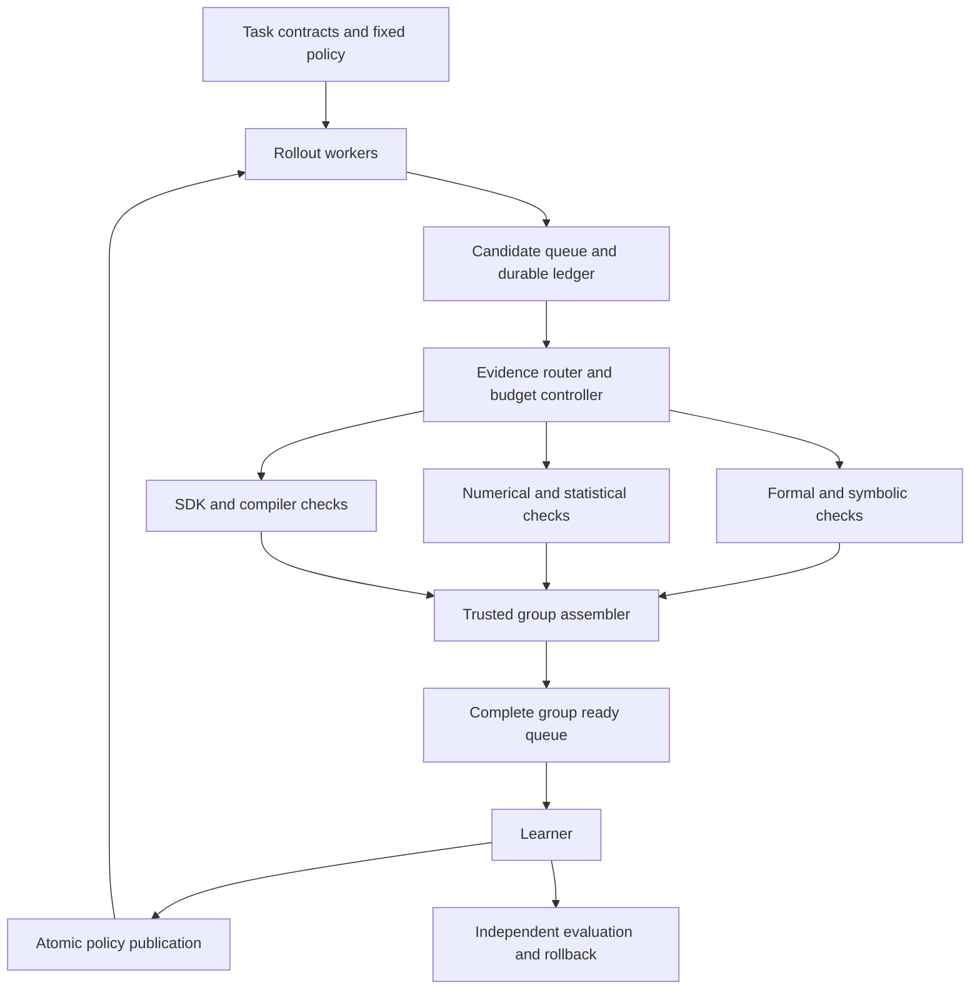

# Quantum Science and Programming Post Training

Research and Engineering Specification for Qwen3.6-35B-A3B

Version 3.1 • 30 October 2026 • Execution platform Future-Code

**Active scope:** RL-only adaptation of the pinned official checkpoint. The [Learning to Clarify R&D plan](LEARNING_TO_CLARIFY_RD_PLAN.md) governs the training sequence, research-agent architecture, task mixture, and adapter-versus-base benchmark contract. This specification supplies engineering details and optional verifier-allocation experiments. No project SFT, demonstration imitation, preference-optimization phase, or trajectory/logit distillation is included. The Word companion is an earlier historical snapshot; current Markdown is authoritative. This revision reports no new model results.

## 1 Objective and research thesis

Develop a quantum science and programming model by post-training a pinned revision of `Qwen/Qwen3.6-35B-A3B`. Improve theoretical reasoning, executable quantum programs, cross-framework translation, circuit optimization, and research analysis while preserving general mathematics, programming, and tool use. The engineering sequence is trusted verification, matched base evaluation, diverse task construction, short-horizon RL cold start, multi-turn research RL, and bounded agent delegation with independent evaluation. Progress depends on evidence gates rather than a fixed calendar.

The central capability thesis is that deliberately designed RL tasks, observations, actions, and independent feedback should teach reusable reasoning, insight, critical judgment, planning, and effective research. Preserve sufficient mathematical/scientific foundations while obtaining long-tail and changing facts through tools. The governing plan defines the capability/intervention matrix and the compact model's resource tradeoffs; these benefits require measurements rather than inference from size alone.

The proposed research thesis is that **the unit of verification should be the semantic contract and the complete policy-update group**. A verifier should establish what a program means in its intended context, and the training system should acquire additional evidence where it can change or certify the group update. Verified failure witnesses can then define public training-task feedback and independent rewards across mathematical and programming representations, without imitation targets.

This thesis yields three research candidates:

1. **Verification allocation for certified group updates.** Allocate expensive checks using a computable bound on reward-induced surrogate uncertainty and the expected increase in certified coefficient magnitude. Use conservative, sign-certified group coefficients when evidence remains incomplete.
2. **Contextual semantic challenges.** Train and evaluate on certified pairs in which an implementation is valid under one contract but fails under a stronger composition context. Measure transfer to unseen combinations of assumptions, contexts, and SDKs.
3. **Witness transfer through RL.** Convert verified failures into typed witnesses and repair environments, then test whether fresh on-policy RL transfers across representations. Tool-disabled evaluation uses the same RL adapter and requires no distillation phase.

These are optional studies subordinate to the active focus-and-research program in the governing R&D plan. Test verifier allocation separately from the inference-time focus policy. Three-track verification, group-based RL, resource rewards, and asynchronous workers have substantial prior art; they do not establish novelty by themselves.

All three candidates are proposed methods. No model improvement, verifier speedup, publication acceptance, or scientific discovery is asserted in this specification. Analytical statements below have explicit assumptions; experimental targets are decisions to freeze before running the study. Deliverables from implementation must include loadable weights, reproducible code, data lineage, independent evaluation, cost accounts, and negative results.

### 1.1 Project boundary

Keep quantum contracts, generators, verifiers, and evaluations in `quantum-computing-gpt` or its project plugin. Future-Code remains a domain-neutral R&D platform responsible for dependencies, remote jobs, budgets, evidence, recovery, and scheduling. Audit and reuse existing components before implementing replacements. SAPO here means Soft Adaptive Policy Optimization. Audit any external implementation before using it; this repository's supervised Qwen trainer is not an implemented SAPO/RL path.

The target model and the orchestration model are distinct: Future-Code may use external LLM APIs to manage the project, while the quantum model is the trainable artifact. Training requires an actual supported runtime and available accelerators. Historical Ascend capacity is a candidate deployment profile, not evidence of current availability. Credentials belong in secret references, outside datasets, reports, checkpoints, and source control.

## 2 Prior art and the remaining research question

The literature reviewed on 22 October 2026 already contains close precedents. The comparison below defines the scope of the proposed contributions; it does not establish priority or exhaust the literature. Repeat the search before submission and inspect newly available code and supplements.

| Prior work | Established overlap | Required distinction in this project |
| --- | --- | --- |
| QUASAR [R1] | Tool-augmented quantum assembly generation and hierarchical RL rewards | Quantify semantic correctness under explicit composition contracts and verification allocation at the group-update level |
| VISTA [R2] | Staged quantum verification and budget-aware evaluation | Compare against stage gating; demonstrate value from group-dependent uncertainty bounds and conservative coefficients |
| RubriQ [R3] | Quantum GRPO with fidelity, hardware, and resource rubrics | Resource-aware quantum GRPO alone is insufficient as a contribution |
| QuantumQA [R4] | Quantum reasoning data and verification-aware rewards | Separate executable certificates from semantic judging and test theory-to-code transfer |
| Range-GRPO [R5] | Reward intervals, pairwise uncertainty weighting, and the point-interval Dr. GRPO limit | Acquire executable evidence adaptively and certify signs relative to the exact mean-centered reward; compare using identical intervals |
| MorphQ and MetaMorphQ [R6, R7] | Quantum metamorphic tests, transformations, and physics-based invariants | Study contract-changing contexts and certified failure witnesses, including transfer between theory and code |
| Quantum compiler assurance survey [R8] | Semantic contracts, interface observations, and inconclusive evidence | Deliver and evaluate a training method and benchmark rather than claim contracts themselves are new |
| AIR-OPD and Learning to Disprove [R9, R10] | Repair distillation and checked counterexample training in prior work | Isolate witness value through matched RL environments; their imitation/distillation phases are outside current scope |
| Confidence sequences and multifidelity policy gradients [R11, R12] | Sequential uncertainty control and use of inexpensive simulation | Do not claim these foundations; distinguish bounded surrogate deviation from unbiased gradient estimation |

Range-GRPO uses interval midpoint differences weighted by the combined uncertainty of each pair. Our proposed conservative coefficient instead abstains whenever the sign of the exact mean-centered advantage is unresolved. This changes the learning objective and can discard useful signal. Its benefit must therefore be demonstrated under equal evidence budgets, not inferred from conservatism. [R5]

VISTA makes verification scheduling a direct baseline, not an optional comparison. The relevant question is whether acquiring evidence according to its effect on a complete group update improves the cost–quality frontier beyond a staged verifier. Where published code cannot be run, label a reconstruction as such and document the differences. [R2]

**Publication decision.** A larger model, a longer context, a broader software stack, or a new acronym is not enough. The study must establish an incremental mechanism, a reproducible implementation, and gains against the nearest feasible alternatives. The elementary bounds in Section 3 support the method; they are not, by themselves, a claim of a new theorem in probability or optimization.

## 3 Research candidate one Verification allocation for group updates

### 3.1 Problem definition

Fix a task, its reward contract, a behavior policy, and a group of G completed candidates. Let `r_i*` be the reward that an ideal verifier would assign to candidate i under that contract. It is a fixed quantity conditional on the candidate and task. For a QEC task, simulator shots estimate an underlying logical failure probability; that probability is mapped through the reward rule. A single noisy success or failure is not the ideal correctness label.

Each trusted verifier returns an interval `[l_i, u_i]` containing `r_i*` under a stated deterministic or statistical guarantee. Exact checked outcomes give point intervals. An unsupported approximation provides no certificate and cannot justify a narrow interval. Initialize unresolved candidates with the full contract support `[-1, 1+b_max]`, which is `[-1, 1.25]` under Section 12. Format validity alone does not exclude other contract violations. Narrow to `[0, 1+b_i]` only after every condition that could produce -1 has been ruled out and the correctness-gated resource bonus `b_i` is known.

The statistical contract is joint coverage over all candidates and all evidence acquisitions that feed committed updates. It must account for adaptive stopping and repeated groups. Marginal coverage of an LLM judge on a held-out calibration set is insufficient for the guarantee below. Correlation between candidates is allowed if the joint coverage claim is valid.

Infrastructure failure remains `VOID` with no usable reward evidence. The default point-reward pipeline quarantines any group containing a null reward. A separately versioned research mode may consume a complete group of valid reward intervals while some semantic verdicts remain `UNKNOWN`. It must retain those verdicts and must never report an interval-based update as a verified PASS.

### 3.2 Exact advantage bounds

Use mean-centered, unstandardized rewards:

`A_i* = r_i* - (1/G) Σ_j r_j*`.

For a rectangular reward uncertainty set, the exact extrema are:

`L_i = (1 - 1/G) l_i - (1/G) Σ_{j≠i} u_j`

`U_i = (1 - 1/G) u_i - (1/G) Σ_{j≠i} l_j`.

Define the conservative coefficient `c_i` as `L_i` when `L_i > 0`, as `U_i` when `U_i < 0`, and as zero otherwise. Detach intervals and coefficients from autograd. Do not re-center or standardize these coefficients afterward: either operation can invalidate their sign interpretation.

**Proposition 1.** On the event that every reward lies in its interval, `A_i*` lies in `[L_i, U_i]`. Every nonzero `c_i` has the sign of `A_i*`, and `|c_i| ≤ |A_i*|`. Point intervals recover the ordinary mean-centered coefficient.

**Proof.** The coefficient of `r_i*` in the centered advantage is positive; every other coefficient is negative. Choosing the corresponding interval endpoints gives the extrema. Selecting the endpoint closest to zero when the interval excludes zero proves the sign and magnitude statements. Substitution proves the point-interval case.

This proposition certifies signs of scalar surrogate coefficients. It does not prove an unbiased policy gradient, alignment of the full parameter update, monotonic policy improvement, or convergence. Conservative coefficients generally do not sum to zero, and abstention changes the objective.

### 3.3 A computable bound for evidence allocation

For a token probability ratio `ρ ≥ 0`, let `q = clip(ρ, 1-ε, 1+ε)` and `f(ρ,a) = min(ρa, qa)`. Compare two losses on exactly the same tokens, masks, fixed completion cap, current policy, and reference KL: one uses `A_i*`, the other uses `c_i`.

Let `w_i = u_i-l_i`, `Δ_i = U_i-L_i`, and define:

`s_i = (1/L_cap) Σ_t m_it max(ρ_it, q_it)`.

**Proposition 2.** On the joint coverage event, the absolute difference between the two clipped surrogate losses, with identical KL terms, is at most:

`B = (1/G) Σ_i s_i Δ_i`.

**Proof.** For fixed ρ, `f` is Lipschitz in its second argument with constant `max(ρ,q)`. Proposition 1 gives `|A_i*-c_i| ≤ Δ_i`, including the abstention case. Apply the triangle inequality to the masked token sum. The identical KL terms cancel.

Because `Δ_i = (1-1/G)w_i + (1/G)Σ_{j≠i}w_j`, the same bound can be written as:

`B = Σ_j k_j w_j`, where `k_j = ((G-1)s_j + Σ_{i≠j}s_i)/G²`.

This decomposition exposes the effect of refining one candidate on the entire group. A candidate with an uncertain reward affects other candidates through their group baseline. It is therefore useful to consider evidence acquisition jointly rather than stopping every candidate at a uniform sample count.

The bound is a surrogate-value bound, not a gradient-error bound. Ratios can exceed the clipping range, so `s_i` must not be silently capped at `1+ε`. Freeze `s_i` only while scoring candidate acquisitions, and recompute the bound at the actual learner policy before updating. Early experiments keep the behavior and learner policy synchronized to reduce this source of drift.

### 3.4 Acquisition policy

Define the certified coefficient mass as `M = (1/G) Σ_i s_i |c_i|`. This is a weighted scalar magnitude, not gradient magnitude or a guarantee of useful learning signal. For nested reward intervals and frozen nonnegative `s_i`, each `L_i` can only increase and each `U_i` can only decrease. Consequently, `|c_i|` and M cannot decrease. Narrowing one candidate's interval can resolve signs or increase certified magnitudes throughout the group.

For an available check a on candidate j, predict its execution cost, interval-width reduction, and change in M using development traces. Rank checks by:

`priority(j,a) = (k_j × E[width reduction] + λ × E[M_after - M_before]) / E[cost]`.

All expectations are conditional on currently revealed evidence and the proposed check. Freeze a positive, dimensionless λ on development data before evaluation; λ=1 is a pilot candidate, not a validated optimum. Use deterministic tie breaking and a minimum service quota for each task family. Predicted reductions and costs cannot narrow an interval or certify correctness. Recompute priorities after each evidence arrival and recompute actual coefficients and M at the learner policy.

**Required degeneration control.** With synchronized policies and equal completion lengths, all `s_i` and `k_j` are equal. The λ=0 allocator then reduces exactly to expected interval-width reduction per cost, up to a shared constant. The mass term adds dependence on reward locations and the other candidates even in this regime. Compare λ>0 against λ=0 and ordinary uncertainty scheduling at matched budgets. Require an incremental end-to-end benefit before attributing gains to the proposed group-dependent acquisition mechanism.

The priority is a heuristic, not an optimal allocation rule. Increasing M does not certify parameter-gradient alignment and can favor easily separated or extreme groups. Preserve family quotas, full generation denominators, and held-out semantic evaluation to expose that selection effect.

Run cheap structural checks first when they can return valid certificates or counterexamples. Increase statistical samples where justified, or switch to an exact or symbolic verifier when statistical evidence is too expensive. A deterministic proof can collapse an interval immediately. An approximate simulator without an error bound may help choose the next check but cannot manufacture a certificate.

Stop acquisition when the bound is below a predeclared tolerance, the group becomes exact, or the group budget expires. At budget expiry, interval mode may use conservative coefficients if the group is complete and all evidence contracts are valid; point mode quarantines unresolved groups. Preserve G and the original denominator in both modes. Never keep only the fastest or successful candidates. Record all abstentions, unresolved verdicts, costs, and family coverage.

```text
freeze task, reward contract, behavior policy, and all G candidates
validate candidate identities and initialize honest reward intervals
while budget remains and bound exceeds the frozen tolerance:
    compute group bounds and acquisition priorities
    execute one eligible trusted check under its evidence budget
    validate its scope and coverage; update that candidate interval
    reject contradictory certificates and infrastructure corruption
recompute ratios, staleness checks, coefficients, and bound at learner
commit one complete group under point mode or interval mode
retain an independent full-verification audit stream
```

Intersect compatible valid intervals to retain accumulated evidence. An empty intersection indicates numerical inconsistency, a violated confidence event, or an implementation error; quarantine it and preserve the evidence rather than selecting the more favorable interval. Changing the candidate, simulator model, noise distribution, or reward contract starts a new evidence stream.

### 3.5 A transparent sequential certificate

For an auditable starting implementation, consider one Bernoulli measurement channel per candidate, such as logical decoding failure under a fixed noise model. Index evidence groups by `m ≥ 1`. Allocate total miscoverage budget δ using:

`δ_m = 6δ / (π²m²)` and `α_m,i,n = 6δ_m / (Gπ²n²)`.

After n fresh shots of a fixed candidate, use a clipped Hoeffding interval around the empirical mean with radius:

`e_n = sqrt(log(2/α_m,i,n)/(2n))`.

At n=0 use `[0,1]`. A union bound over groups, candidates, and sample counts gives total miscoverage at most δ. Sampling must be conditionally independent with the specified fixed Bernoulli law given the candidate and prior history. Adaptive allocation across candidates is compatible with this construction; adaptive changes to their underlying distributions are not. Additional observables, new candidates, retries that restart inference, and repeated certification claims require explicit entries in the error-budget ledger.

Map the probability interval through the **entire reward rule**, taking the image or a valid enclosing interval. For example, when a correctness bonus depends on `p ≤ p_max`, an interval crossing `p_max` must preserve both pass and fail rewards. It cannot be replaced by a bonus computed at the midpoint. Add certified numerical or truncation error separately; statistical concentration does not bound simulator bias.

This construction is deliberately simple and often conservative. Tighter confidence sequences can be substituted after independent derivation and calibration tests. Near-zero logical error rates and near-unit fidelity can make naive concentration prohibitively costly; the experiment must measure this limit and allow exact or structural fallback. Confidence-sequence theory is prior work. [R11]

### 3.6 What would establish value

First use a frozen candidate pool whose reference rewards can be fully resolved. Replay competing acquisition policies against the same pool. Measure false acceptance, interval coverage, incorrect nonzero signs, abstention, surrogate deviation, verifier cost, and family coverage. Check actual surrogate error against the predicted bound. This isolates verification from changes in the model distribution.

Then use a factorial study: coefficient rule {midpoint Dr. GRPO, Range-GRPO, conservative coefficients} × allocator {uniform, staged gating, bound-only λ=0, proposed λ>0 allocation}. Within each allocator, evaluate coefficient rules on identical attained intervals. Across allocators, fix initial information and observation streams but permit different revealed evidence and final intervals. Include full-verification Dr. GRPO as the accuracy reference. Match candidate pools for replay and training tokens, evidence budgets, model revisions, and evaluation protocols for end-to-end studies. Report synchronized, equal-length replay separately to test the degeneration described above.

A proposed go/no-go target is at least 20% lower verifier cost at a predeclared accuracy noninferiority margin, with no increase in false acceptance and no unexplained family-coverage loss. Freeze the numerical target and margin from an independent pilot. If only the allocator helps, claim an allocation method. If only conservative coefficients help, narrow the claim accordingly. If the confidence bounds force almost universal abstention, redesign or reject the method.

## 4 Research candidate two Contextual semantic challenges

### 4.1 The semantic unit

A task contract records the object being implemented, its input and output spaces, wire and classical-bit maps, allowed operations, ancilla obligations, phase convention, approximation metric, parameter domain, hardware target, and intended composition contexts. These fields identify which equivalence relation is relevant. A standalone quantum channel and a coherently controlled implementation are different interfaces.

Build a challenge record from a root specification, a candidate implementation, an allowed context, and a certificate or independently verified witness. Distinguish two transformation classes. An equivalence-preserving transform transports a known-valid solution under stated assumptions. A contract-changing transform strengthens or changes the required behavior and must be reverified; it must never inherit a positive label automatically.

Existing metamorphic testing already includes transformed quantum programs and combinations of transformations. The proposed delta is a learning and evaluation protocol built around **changes in validity under context**, connected to matching mathematical statements and executable witnesses. [R6, R7, R8]

### 4.2 A canonical phase challenge

Let `U = I` and `V = -I`. As standalone unitary channels they act identically on density matrices, and their phase-invariant process fidelity is 1. However, controlled-U is the identity while controlled-V applies Z to the control qubit. On `|+> ⊗ |0>`, the outputs have orthogonal control states `|+>` and `|->`. A comparison that removes global phase from the subroutine would miss the error in the controlled context.

For the general relation `V = exp(iφ)U`, the phase-invariant process fidelity of their controlled extensions is `cos²(φ/2)`. This follows by taking the normalized trace of `diag(I, exp(iφ)I)`. The example is established quantum mechanics, not a new discovery. Its role is to provide an exact diagnostic linking a theorem, a circuit, and a composition contract.

Represent the witness as a small state-preparation and measurement program, rather than a dense statevector whenever possible. Replaying it should distinguish the two implementations under the declared context. The context must expose the effect physically; computational-basis probabilities alone can conceal phase errors.

### 4.3 Challenge families and controlled interventions

| Intervention | Paired semantic question | Required evidence |
| --- | --- | --- |
| Add coherent control | Does a phase-equivalent subroutine remain valid? | Exact small-matrix comparison or a phase-sensitive witness |
| Change wire or bit interpretation | Does the delivered interface preserve the declared mapping? | Independent mapping oracle and asymmetric test inputs |
| Reuse an ancilla | Is the ancilla returned to the required state and uncorrelated? | Joint-state or channel check, including superposition inputs |
| Add an entangled reference | Does behavior hold beyond the tested product inputs? | Channel or reference-assisted witness at supported size |
| Change theorem assumptions | Does the statement remain true without commutativity or invertibility? | A new proof or a verified counterexample |
| Change approximation scope | Is an average-error bound adequate for this application? | The specified norm or an explicit separating example |
| Compose contexts and SDK translation | Do locally correct parts remain correct at the exposed interface? | End-to-end independent execution and provenance |

For every root, retain valid and invalid instances with comparable surface form. A valid task must not be identifiable simply because it has more assumptions, a longer prompt, or a particular error word. Audit label balance by syntax and family. Include legitimate classical preprocessing and state preparation when the contract permits them; a generic ban would create spurious negatives.

An elementary compositional bound provides another oracle. If unitary implementations satisfy `||U-V||op ≤ ε` with a fixed phase convention, then a unitary circuit context containing k occurrences has discrepancy at most `kε` by a telescoping expansion and unitary norm invariance. Controlled embeddings preserve the block difference norm. This bound does not automatically apply to arbitrary postselection, renormalization, or a phase-minimized distance. Each broader context needs its own proof obligations.

### 4.4 Training and evaluation design

Split root algorithms, source theorems, seed ancestors, and witness schemas before generating variants. Include three distinct tests: new instances of known contexts, unseen context combinations, and transfer to an SDK or representation excluded from a specific training slice. Report these separately. Holding out a framework is a deliberate subexperiment, not a reason to omit ordinary multi-framework training from the main model.

Compare ordinary random augmentation, MorphQ-style invariance augmentation, contextual positive pairs alone, positive plus certified negative pairs, and the full RL curriculum. Match unique roots, rollout/update tokens, task-generation effort, and verification cost. Hold out mutation templates as well as numerical parameters to test whether the model learns the underlying obligation.

The primary benchmark metric is **paired semantic accuracy**: both the ordinary-context task and its changed-context task must be answered correctly. Report the fraction of a root's contexts solved together, failure-witness validity, false rejection of valid implementations, and circuit cost conditional on correctness. Root-level macro averages prevent a prolific generator from dominating the score.

A useful publication result would show fewer accepted semantic failures and better held-out composition performance than equal-size ordinary augmentation, with corroborating theory-to-code transfer. A collection of known phase or endianness examples without generalization evidence supports a test suite, but a weaker research claim.

Coherent-control challenges use known circuit descriptions with a declared phase reference. They do not assume that an arbitrary unknown black-box unitary can be turned into a controlled unitary. Include independently adjudicated real SDK or compiler failures alongside generated mutants, and report valid-case retention to expose overly aggressive rejection.

## 5 Research candidate three Witness transfer through RL

### 5.1 Witness environments

A witness is a checkable refutation of a candidate under a specified contract, with contract/candidate hashes, witness program or proof, observed discrepancy, verifier, and scope. Examples include a controlled-phase context, wire map, ancilla-reuse context, or finite-dimensional counterexample.

Collect genuine failures on training roots, independently replay their witnesses, and reduce them with a recorded bounded procedure. Call a witness reduced rather than minimal unless minimality is proved. Build related mathematical and SDK tasks with explicit, freshly verified transformations. Keep failed attempts and lineage.

Supply only permitted public feedback to new on-policy repair or witness-construction episodes. Do not create successful-answer targets for cross-entropy, preference optimization, or trace/logit distillation. Privileged final-test inputs never enter the actor context. A changed assumption defines a different problem rather than a refutation of the original theorem.

### 5.2 Experimental separation

Compare outcome-only RL, generic compiler-feedback RL, checked-witness RL, and checked witnesses with cross-representation tasks. Match roots, rollout/update tokens, feedback exposure, teacher/task-generation effort, and verifier cost. Add shuffled-witness and no-reduction controls. The cited repair/distillation work is prior art [R9, R10], not an instruction to add those training phases.

Freeze root- and witness-schema-disjoint evaluation before constructing views. Measure valid counterexamples, defect recurrence, and theory-to-code/code-to-theory transfer. New wording of the same failure is not independent transfer.

### 5.3 Tool-disabled diagnostic

Report untouched base and the same RL adapter both with and without the identical research harness. This diagnoses unaided transfer and tool dependence without training a separate distilled model. The intended deployment permits research tools; zero-tool memorization is not a promotion prerequisite.

## 6 Publication study and claim discipline

### 6.1 Optional verifier-allocation study

For the optional verifier-allocation paper, the question is: **Can executable evidence acquired for a complete group update reduce quantum post-training verification cost without sacrificing independently measured semantic correctness?** The governing plan's focus-and-research RL study remains the project priority. Use contextual tasks to expose failures that easy syntax or output-distribution tests miss. Begin on small exact circuits and fixed statistical QEC tasks, where reference outcomes can be adjudicated, before extending to symbolic proofs or approximate dynamics.

The paper should contain a precise algorithm, the two supporting propositions with assumptions, reproducible verifier interfaces, the contextual benchmark, a cost-accounted replay experiment, and an end-to-end post-training study. A larger model alone is an application choice. Add a smaller model for accessible reproduction if resources allow, while retaining the requested Qwen model as the main engineering target.

| Study | Fixed controls | Decisive evidence |
| --- | --- | --- |
| Verifier replay | Same candidates, contracts, available observation streams, and total budget | Cost versus reference correctness; bound validity; coverage and abstention |
| Coefficient by allocator factorial | Same initial information and evidence budget; identical attained intervals within each allocator | Separate contribution of coefficients and scheduling |
| Context challenge curriculum | Same roots, rollout/update tokens, and task-generation budget | Paired correctness on unseen contracts and compositions |
| Witness transfer | Matched on-policy exposure and feedback budget | First-attempt gain on held-out witness families and representations |
| End-to-end system | Same model, prompt, decoding, and deployment budget | Science and coding gains with general-capability guardrails |
| Runtime scaling | Same workload and evidence contract | Useful throughput, queue latency, staleness, restart behavior, and total cost |

For replay, freeze initial intervals, oracle definitions, confidence budgets, and pre-generated per-candidate observation streams. Allocators may reveal different prefixes and attain different intervals; charge only the revealed evidence and prohibit inspection of future samples. Within an allocator, compare coefficient rules on the same attained intervals. This separates a coefficient treatment from an allocation treatment without erasing either one.

Besides uniform and stage-gated acquisition, include cheapest-first, uncertainty-only scheduling, and the λ=0 degeneration control. Match the λ>0 method's tuning budget to its comparators. Multifidelity best-arm identification is a relevant allocation foundation, although its objective differs from bounding a complete group surrogate. Do not infer allocation optimality from its literature or from the greedy heuristic. [R13]

### 6.2 Metrics and statistical unit

Use root tasks or independent source families as the statistical unit. Parameter variants from one generator are correlated. Bootstrap paired model differences at the family level, and disclose training-seed variation separately. Predefine primary endpoints, noninferiority margins, confidence levels, and handling of multiple comparisons. Use development data for algorithm selection and an independent pilot for power analysis.

Primary research metrics are semantic first-attempt success, verified successes per unit verifier cost, and the cost–accuracy frontier. Secondary diagnostics include incorrect nonzero coefficients, interval coverage, surrogate discrepancy, update abstention, family coverage, tokens, energy where measured, accelerator hours, CPU hours, and total expenditure. Reporting only accepted groups would conceal selection effects; retain the complete generation and verification denominator.

At least three training seeds are a proposed starting point, subject to the budget. Approximately 1,000 sealed tasks across at least 100 roots or families is a design starting point rather than a power guarantee. Increase independence and coverage before multiplying near-duplicate variants. Use exact small-instance oracles to audit statistical claims, including cases near reward thresholds and cases that force simulator fallback.

### 6.3 Evidence required for each claim

| Proposed claim | Required result | Claim to withhold if absent |
| --- | --- | --- |
| Better verification efficiency | Lower measured total verification cost at matched accuracy and coverage | General superiority from a faster easy-task subset |
| Safer training coefficients | Valid simultaneous coverage and fewer incorrect nonzero signs | Unbiased gradients or guaranteed learning improvement |
| Better contextual semantics | Higher paired accuracy on unseen root/context combinations | General quantum reasoning from familiar mutants |
| Transferable witnesses | RL gains beyond matched repair feedback across held-out representations | Universal discovery or transfer from rewritten versions of one failure |
| Better quantum model | Separate science and coding gains over a matched official baseline | Broad scientific improvement from one SDK benchmark |

Prepare plots only from measured results: cost–accuracy frontiers, coverage versus confidence budget, predicted versus observed surrogate discrepancy, per-family semantic errors, ablations, and training stability. Mark unrun cells `NOT MEASURED`. No performance chart should be populated with a guessed response to group size or reward weight.

### 6.4 Manuscript and release plan

Maintain a related-work ledger with citation, exact overlapping mechanism, implementation availability, and the remaining delta. The introduction should state the verification bottleneck and the specific group-level decision problem. Methods should separate mathematical guarantees, scheduling heuristics, and implementation choices. Results should include negative findings and overhead, followed by limits on scale, simulation assumptions, and generalization.

A publication package should contain frozen source, dependency locks, task generators, lawful distributable data or reconstruction scripts, candidate pools, evidence ledgers, raw scores, statistical analysis, and artifact hashes. Preserve a private sealed test until model selection is complete, then publish an appropriate release version with its evaluation protocol. Novelty and venue fit must be reassessed against the literature available at submission. Choose an ML venue if the learning mechanism dominates, a software-engineering venue if contextual correctness and the benchmark dominate, or a quantum-software venue if the strongest result concerns synthesis and verification.

## 7 Capability scope and evidence levels

### 7.1 Science and programming coverage

Science tasks must cover definitions, assumptions, derivations, counterexamples, approximation limits, and evidence quality. A correct answer may refute the premise. Open problems can generate subquestions, experiments, and conjectures, but they do not receive positive labels from an LLM's assertion of success.

| Capability family | Example tasks | Main evidence |
| --- | --- | --- |
| Operators and linear algebra | Tensor indices, partial trace, Pauli identities | Exact symbolic checks and finite-dimensional proofs |
| Quantum information | Entropy, trace distance, channels, entanglement | Audited assumptions, proofs, and small counterexamples |
| Algorithms | QFT, QPE, Grover, amplitude estimation | Input/output semantics and query constraints |
| Dynamics and open systems | Trotter error, Lindblad dynamics, conservation | Analytic identities, convergence, and channel validity |
| Error correction | Stabilizers, logical operators, decoding | Commutation, code certificates, and statistical intervals |
| Variational algorithms | VQE, QAOA, gradients, sampling | Gradient checks, energy estimates, and classical baselines |
| Research analysis | Reproduction, experimental design, assumptions | Reproducible artifacts and independent expert review |
| Software engineering | Generation, repair, translation, small projects | Isolated execution and independent semantic tests |

Initially support Qiskit, MindQuantum, PennyLane, and a declared OpenQASM 3 subset. Resolve MindQuantum's actual package version and interfaces. Add Cirq, Q#, or QIR only with explicit adapter tests. Include English and Chinese task slices to preserve application coverage; the specification and its technical documentation are written in English. [S8–S10, S23]

### 7.2 Evidence taxonomy

| Evidence level | Meaning | Supported conclusion |
| --- | --- | --- |
| FORMAL | Trusted theorem and proof replay with dependency audit | The encoded statement holds in the declared logic |
| STRUCTURAL | Replayable identities, tableaux, or rewrite certificates | Equivalence within the certificate's scope |
| NUMERICAL | Complete finite computation at declared precision | Numerical correctness for that finite instance |
| STATISTICAL | Valid fixed-sample or sequential inference | A stated confidence claim under its sampling assumptions |
| APPROXIMATE | Truncated or heuristic computation with error reporting | An estimate within its stated limitations |
| UNVERIFIED | Insufficient evidence or language-only assessment | A research candidate rather than a strict pass |

Task contracts specify acceptable methods, not just a nominal rank. A statistical interval cannot replace a required formal proof, and a formal proof of a mistranslated theorem does not validate the original scientific claim. Keep execution status `PASS / FAIL / VOID / UNKNOWN` separate from evidence level and from any interval-based training coefficient.

## 8 Model and hardware implementation

### 8.1 Model identity and adaptation

Use `Qwen/Qwen3.6-35B-A3B` as the official post-trained starting point. Its configuration uses `qwen3_5_moe` and a mixed architecture; inspect the downloaded configuration rather than inferring support from the model name. Pin the immutable revision and hashes for all shards, indices, configuration, tokenizer, processor, and chat template. Existing Qwen3.5 or dense-model results are historical comparisons, not the primary baseline. [S1, S2]

The first experiment targets text-based science and programming. Freeze visual components and retain a multimodal smoke test. Use a supported text path; do not alter model types or dimensions to suppress loader errors. Enumerate real parameter names and shapes before defining LoRA targets. Fused MoE expert tensors may require parameter-level targeting rather than dense-layer assumptions. [S3]

Begin with verified attention-projection LoRA, rank 16 or 32, while freezing router, embeddings, output head, and vision modules. Expand trainable components only through ablations. Verify that trainable parameters are nonzero, present in the optimizer, receive finite gradients, and change after an update. A zero-initialized adapter should match the base model within a declared tolerance; a trained adapter must be demonstrably active after reload.

### 8.2 Compatibility gates

1. Discover the real node: accelerator type/count/memory, CPU architecture, interconnect, storage, driver, and queue availability. Historical 8–16 device configurations are planning profiles only.
2. Freeze the PyTorch, Transformers, PEFT, training backend, rollout backend, and driver combination. A historical config version is not a tested dependency lock.
3. Run short BF16 inference and check tokenizer, EOS, padding, chat template, and native reasoning mode. Record settings explicitly.
4. Run forward, backward, optimizer update, checkpoint, process termination, resume, and evaluation. Check parameter and optimizer-state continuity.
5. Test training loading and rollout loading separately, including merged versus dynamic adapters, behavior log probabilities, and weight distribution.
6. Load the final artifact in a fresh process. Adapter failure must stop evaluation rather than silently use base weights.

vLLM-Ascend provides a deployment entry for the target model, but inference support does not establish LoRA training compatibility. A pinned verl/FSDP or Megatron path is a candidate implementation, subject to the same gates. Use one backend for the initial loop. [S4, S5]

### 8.3 Memory and resource policy

At two bytes per parameter, 35 billion parameters imply approximately 70 GB of raw weights before activations, caches, communication buffers, and runtime overhead. A rough 16-byte-per-parameter full-Adam configuration would require about 560 GB for parameter-related storage before sharding and other costs. Active parameters describe per-token computation, not total weight residency. LoRA reduces trainable state; it does not remove base-model memory.

Use CPU verification first, a limited-device LoRA profile next, and separated learner/rollout/verifier pools only after measuring the bottleneck. Begin with 4k input and 4k output budgets. Expand to longer contexts only when valuable answers are truncated and measured gains justify the cost. Do not increase group size and context length in the same causal comparison.

cuQuantum is a CUDA simulator path, not a default Ascend backend. Keep a portable CPU verifier baseline. GPU and NPU deployment profiles must have independent compatibility evidence. Hardware counts, throughput, 95% MFU, and subsecond proof latency are measurements to obtain rather than service guarantees. [S12, S24]

## 9 Three verification tracks

### 9.1 Common trusted interface

Workers share a task registry, resource router, and result schema. Prewarm immutable dependencies, but isolate each candidate execution in a fresh process or sandbox. Ray and gRPC are options, not mandatory simultaneous dependencies. Use one durable queue and ledger architecture before adding more infrastructure.

Candidate code can submit a proof body, program, or normalized circuit. Hidden references, tests, reward computation, and signing material remain on the trusted side. Enforce no network, read-only dependencies, a bounded temporary directory, and CPU, memory, PID, output, and wall-time quotas. Kill the entire process tree at hard timeout. Read-only tests alone do not prevent answer reading, monkeypatching, or fabricated output.

### 9.2 Track A Formal and symbolic verification

Start with finite complex matrices, tensor products, stabilizers, and supported information-theory lemmas. Pin Lean, mathlib, and candidate quantum libraries by commit. Check the actual maturity of each imported module; do not assume a library name implies coverage of advanced quantum theory. Missing definitions require foundational work or a lower evidence classification. [S14–S16]

Fix the theorem type, assumptions, imports, namespace, dependency allowlist, and environment hash. The candidate supplies a proof expression. Compare the elaborated theorem type with the trusted challenge and audit its dependency closure. Reject `sorryAx`, unapproved axioms, shadowed definitions, and statement replacement. Explicitly allow any standard logical axioms required by the chosen foundation.

Every proof receiving positive reward must be replayed outside the candidate boundary and checked against the trusted challenge. Tactics, macros, and elaboration can execute metaprograms; candidate build logs and exit codes are not proof certificates. Cache pinned dependencies, not an untrusted claimed result. Precompiled `.olean` files may reduce startup cost, but actual latency must be measured. [S14]

SymPy checks use explicit algebraic assumptions. Random substitution can find a counterexample but cannot prove a general identity. PyZX certificates must preserve supported scalar, boundary, and phase semantics. Failure to simplify means UNKNOWN, not automatically false. Do not reward a decrease in the number of Lean goals; use independently checked, predefined sublemmas only in a separate process-reward experiment. [S13]

### 9.3 Track B Numerical and statistical verification

Route using qubit count, depth, gate structure, measurements, resets, noise, connectivity, requested output object, precision, and certificate requirements. Qubit and T-gate counts alone are insufficient. For complex128 storage, a statevector uses `16 × 2^n` bytes, a dense unitary or density matrix uses `16 × 4^n`, and a generic dense channel Choi matrix uses `16 × 16^n`.

| Object | 8 qubits | 12 qubits | 18 qubits |
| --- | --- | --- | --- |
| Statevector | 4 KiB | 64 KiB | 4 MiB |
| Unitary or density matrix | 1 MiB | 256 MiB | 1 TiB |
| Generic Choi matrix | 64 GiB | 4 PiB | 64 ZiB |

These are raw single-object sizes, excluding workspaces and copies. Start full-unitary comparison around n≤8 and generic Choi comparison at smaller sizes, then expand using measured limits. A statevector permits larger instances but checks only its input state. Matching a few states does not prove full operator equivalence.

For dimension d, legal unitaries U and V have phase-invariant process fidelity `F_pro = |Tr(U†V)|²/d²`. The average gate fidelity is `(dF_pro+1)/(d+1)`. Average fidelity is not a worst-case norm bound. Tasks requiring coherent control or phase-sensitive reuse must use a phase-anchored contract or test the required controlled extension. [S11]

For noisy or nonunitary tasks, use consistent Choi, Kraus, or superoperator conventions. Test complete positivity and trace preservation, then compare the declared channel metric. CPTP is a validity condition rather than a separate fidelity definition. Mid-circuit measurement requires checking classical outcomes, branching, and output registers.

Stim applies to its supported stabilizer, measurement, and noise operations. Route general non-Clifford cases elsewhere. For QEC, pin code, rounds, noise parameters, decoder, and decomposition assumptions; report logical error rates with valid intervals. Zero observed failures imply an upper bound, not a zero true rate. Code distance needs an independent proof or search certificate. PyMatching assumptions belong in the result. [S17, S18]

MPS and other approximate routes must record bond dimension, truncation, contraction choices, numerical error, and cross-checks. Empirical convergence does not create a rigorous error bound. Unbounded approximations cannot activate strict equivalence rewards or narrow certified reward intervals.

### 9.4 Track C SDK execution and hardware compilation

Define a normalized IR containing ordered wires, classical registers, gates, symbolic parameters, controls, measurements, reset, outputs, phase, and ancilla obligations. OpenQASM 3 and QIR are possible exchange formats with different roles; neither guarantees lossless round-tripping through every SDK. Declare supported subsets per adapter. A legal but unsupported task is UNKNOWN; violating an explicit task restriction is FAIL. [S23]

Build golden tests for asymmetric rotations, basis inputs, superpositions, complex phase, controls, density matrices, and classical output maps. Record tensor axes and wire order rather than assigning a single endianness label to an entire framework. Qiskit distinguishes circuit-list, bit-string, integer, and statevector conventions. [S8]

Pin native gates, coupling map, layout, routing algorithm, optimization level, random seed, approximation tolerance, and compilation time budget. Report logical T-count/T-depth separately from physical two-qubit count/depth and SWAP overhead. Arbitrary NISQ rotations are not all single T gates. Clifford+T synthesis requires a fixed approximation contract before resource comparison.

Execute candidate code in isolation, extract controlled output, then independently parse and simulate it on the trusted side. Pin signatures and oracle access. Classical preprocessing and state preparation are legitimate when allowed; identify cheating from the declared task and query/resource requirements, not from a blanket AST ban on a library call.

### 9.5 Service budgets and outcomes

Initial timeout profiles may be 1.5/5 seconds soft/hard for fast tasks, 10/30 for medium tasks, and 60/300 for slow tasks. Calibrate by workload before freezing them. Add memory and CPU budgets and separate queues for expensive proofs and simulations.

Candidate resource exhaustion can be FAIL with `candidate_budget_exceeded`. Worker crashes, corrupt environments, scheduler faults, and invalid measurement configuration are VOID. Insufficient evidence within a legitimate verification budget is UNKNOWN. Report per-family P50/P95/P99 latency, memory, timeout rate, and useful completed groups; do not present aggregate fast-task throughput as universal capacity.

## 10 Data generation and lineage

### 10.1 Sources and roles

Register sources before synthesis, with URL, revision, license, intended role, access date, and transformation lineage. SDK examples can support training under their terms. Public evaluation suites and their derivatives stay outside training. Public availability does not establish redistribution permission or absence from the base model's pretraining.

Candidate resources include SDK documentation, Physlib and LeanQuantum, Qiskit HumanEval, MQT Bench, QASMBench, Microsoft QDK and Quantum Katas, and individual research papers with their authorized code. Verify file-level licenses and versions at ingestion. Do not require an unverified benchmark name such as QASMTransBench; first resolve its actual repository and protocol. [S9, S10, S15, S16, S19–S23]

### 10.2 Circuit and software synthesis

Generate a feasible reference circuit, then apply certified identities, decompositions, commutations, or ZX rewrites. Save rule IDs, parameters, before/after hashes, and certificates. Check phase and context preconditions for every transformation. Name the reference `C_ref_feasible`; its cost is an upper bound on the optimum for a minimization problem. Claim global optimality only with a corresponding search or lower-bound certificate.

Include real algorithm structures, subroutine composition, random circuits, and held-out rewrite combinations. Adjacent inverse-gate deletion is useful for a smoke test but cannot dominate the task distribution. Track gate distributions, structure, depth, and optimality evidence.

Generate SDK implementations through the normalized IR and verify them independently. Inject realistic faults: swapped controls and targets, missing phase corrections, wire maps, measurement ordering, angle units, dimensionality, API changes, gradient interfaces, and seed handling. Preserve failed version, public feedback, repaired version, and hidden evaluation. Use a second backend or small direct linear algebra oracle to avoid a shared generator/verifier bug.

For sampling tests, specify a distance, tolerance, and power. Failure to reject a chi-square test is not a proof of equal distributions. Apply the contextual and witness methods as distinct, cost-matched data-generation branches.

### 10.3 Theory and research synthesis

Build a dependency graph linking definitions, assumptions, statements, proofs, and verifiers. Generate valid lemmas, missing-assumption tasks, false statements, and verified counterexamples. Keep finite-dimensional claims distinct from infinite-dimensional ones; do not silently add invertibility, commutativity, full rank, or boundedness during formalization.

Use two reviews for paper formalization: fidelity of the formal statement to the source, then validity of its proof. Advanced results enter FORMAL tasks only when their definitions and dependencies exist. Otherwise preserve them as research-analysis tasks with the appropriate evidence status. At least one dedicated family must reward a correct refutation of an invalid premise.

### 10.4 Scale and sampling

Start with the governing plan's 120-root development pilot and work toward 2,000 independently reviewed training roots. Expand only when measured structural coverage, useful reward signal, and compute justify it. Count unique roots separately from variants and rollout trajectories; duplicated prompts do not satisfy a diversity target.

Use the governing plan's initial RL task mixture and development-only curriculum decisions. Teachers may propose tasks, public source material, or evaluator rubrics after independent admission; do not fit their answers, traces, or logits. Fresh policy rollouts include failures. Teacher confidence and explanation length are not correctness labels.

### 10.5 Split before transformation

Split source documents, theorem families, algorithm skeletons, seed ancestors, and witness schemas before generating variants. Keep each root's rewrites, SDK translations, counterexamples, and repair history within its assigned split. Maintain training, development, validation, and sealed final-test partitions. The sealed test cannot enter teacher prompts, RAG, tool feedback, curriculum selection, or debugging.

Audit raw hashes, normalized ASTs, text similarity, circuit ancestry, theorem dependencies, parameter ranges, and caches. Quarantine unresolved overlap. The manifest must close both accounting identities: `input = accepted + rejected + processing_failed`, and `unique accepted = train + dev + validation + sealed_test` for disjoint partitions. Looking at a sealed test consumes it for further adaptive development; use a new version for subsequent confirmatory claims.

## 11 RL-only readiness and cold start

Start from the official post-trained checkpoint with a fresh adapter and frozen base/router weights. There is no additional project SFT, knowledge pretraining, demonstration replay, or distillation phase. The existing supervised trainer is a legacy utility and cannot satisfy the RL gate.

Measure base tool compliance and success by family. Begin with short, solvable, independently verified training tasks and complete on-policy groups. If rewards are constant, diagnose task validity, API/environment mismatch, source access, parsing, and reasoning difficulty. Simplify training contracts or decompose them into checkable subproblems; record and progressively remove public hints. Never change sealed evaluation tasks to improve reward.

| Item | Initial candidate | Gate |
| --- | --- | --- |
| Adaptation | Discovered attention-projection LoRA targets, rank 8/16 | Actual gradient, save, reload, and adapter-disabled checks |
| Base/router | Frozen | Trainable-parameter audit and retention diagnostics |
| RL learning rate | Small development-selected grid | Independent loss audit and useful development gains |
| Group and updates | G=4, one optimizer update per complete group | Full behavior-policy identity and consumption record |
| Actor mask | Generated actor tokens only | Exclude prompts, observations, padding, foreign workers; independent span audit |
| Curriculum | Short derivation/circuit/tool tasks before research episodes | Nonzero reward support and fixed family monitoring |
| Checkpoint | Adapter, optimizer, scheduler, RNG, sampler/cursor | Fresh-process resume without duplicate group consumption |

Quantization, expert adapters, full-parameter RL, and asynchronous rollout require separate target-runtime and capacity evidence. Passing interface syntax does not prove learnability. If a family remains unsolved after valid scaffolding and diagnosis, record the limitation rather than silently adding supervised training.

## 12 Reward contract and baseline reinforcement learning

### 12.1 Correctness gates

Implement a simple terminal reward before adding shaping. All constants below are experimental choices to freeze and version.

| Trusted outcome | Point reward | Treatment |
| --- | --- | --- |
| VOID or insufficient evidence | null | Retry under policy or quarantine the group |
| Tampering, explicit contract violation, or invalid format | -1.0 | Record the specific candidate-caused failure |
| Valid format but incorrect solution | 0.0 | No reward for apparent progress |
| Correct solution satisfying hard resource constraints | 1.0 + b | Resource bonus b lies in [0, 0.25] |

Hard gate limits, oracle queries, ancilla rules, and approximation error are part of correctness. A bonus cannot compensate for violating them. A model's printed fidelity or a candidate-provided test is not trusted evidence. Partial formal proofs receive no terminal correctness credit. Predeclared sublemma rewards or bounded continuous shaping are separate experiments and do not alter strict Pass metrics.

For applicable resource j, fix reference cost `c_ref_j`, candidate cost `c_j`, and weights summing to one:

`b = 0.25 Σ_j w_j clip((c_ref_j-c_j)/c_ref_j, 0, 1)`.

Use the ratio only when the reference cost is positive. A zero-cost reference receives no improvement bonus for that component, and any increase remains visible. Remove or reweight inapplicable components when constructing the task, not after seeing the answer. Report T resources separately from NISQ routing resources and add guardrails on omitted costs.

Reference compilers include the feasible input circuit, a pinned Qiskit configuration, and PyZX where appropriate. MQT QCEC is a useful independent equivalence checker; its partial-equivalence, ancilla, output, and phase settings must match the task contract. It is established verification infrastructure rather than a project innovation. [S13, R14]

Compare paired resource costs where both solutions are correct, alongside overall end-to-end success. Otherwise a method could appear efficient merely by failing difficult tasks. Statistical reward inputs use valid intervals or fixed sampling designs. Repeated testing until a lucky pass is prohibited.

### 12.2 Explicit baseline objective

Use a versioned Dr. GRPO-style objective with a separately specified reference KL. For G candidates from behavior policy π_b, define `A_i = r_i-mean(r)` without group-standard-deviation normalization. For generated token t, define `ρ_it = exp(log π_θ - log π_b)`. With mask m and a fixed completion cap:

`L = -Σ_i,t m_it min(ρ_it A_i, clip(ρ_it,1-ε,1+ε) A_i)/(G L_cap) + β KL_ref`.

The initial reference KL is the full-vocabulary divergence `KL(π_θ(.|h)||π_ref(.|h))`, averaged over valid generated-token histories h from the behavior rollouts. Freeze the untouched official reference checkpoint and its hash; ensure no adapter is active on the reference. Reference probabilities, histories, rewards, advantages, and behavior log probabilities are detached; current-policy probabilities retain gradients. Chunk vocabulary computation if needed and verify the global sum.

This KL regularizes sampled histories; it is not asserted to equal KL between full current-policy trajectory distributions. A sampled approximation requires a new objective contract with its sampling law and gradient treatment. Constant rewards make the policy-reward term zero, while KL can still generate gradients. Test the total zero-gradient case separately with β=0.

Start with ε=0.2 and a small β candidate such as 0.01, selected on development data. DAPO has distinct token aggregation, clipping, sampling, and truncation choices; do not interchange names or inherit defaults silently. Independently recompute loss and gradients on tiny fixtures before training. [S6, S7]

The Section 3 research branch replaces `A_i` with `c_i` and records the bound B. Its name, interval policy, statistical budget, and selection behavior belong in a new contract. It must be compared with the point baseline, not silently substituted into it.

### 12.3 Sampling and curriculum

Start with G=4 or 8. Compare larger groups only after measuring effective updates per unit cost. Store exact prompt/token IDs, behavior revision, generation settings, stop reason, and log probabilities. Initially use temperature 1, no top-k/top-p truncation, and no repetition penalty. If sampling transformations are introduced, define the behavior distribution, importance ratios, and support restrictions explicitly.

Detect zero signal from total reward variance, not binary success alone. All-pass groups can still differ in resource reward. All-fail groups can retain signal from invalid outcomes at -1 versus semantically incorrect outcomes at 0. Additional shaping requires a separately specified contract. Retain zero-signal statistics and revisit task families; do not permanently remove them. Cap resampling attempts and tokens rather than loop indefinitely for a mixed group.

Use a curriculum from basic operators and small exact circuits to multi-framework, noise, fault tolerance, and certified advanced subproblems. Maintain a fixed-distribution diagnostic stream to detect neglect of slow or difficult families. Curriculum decisions use development performance and coverage as well as training rewards.

### 12.4 Training health

Track generated and trained tokens, reward variance, zero-signal groups, entropy, KL, clipping fraction, gradients, adapter changes, truncation, family success, and cost per effective update. Stop on nonfinite losses or persistent absent parameter updates. Candidate initial alarms include truncation above 5%, VOID above 2%, and excessive stale-group rejection; freeze the windows and thresholds after the canary.

Three planned evaluations without meaningful development improvement trigger diagnosis rather than automatic extension. Compare SAPO and the clipped control from the same official initialization with matched data, token budget, and verification contract, after validating the actual implementation. Keep the path supported by evidence.

## 13 Asynchronous execution and recovery

### 13.1 Architecture and initial operating mode

First validate a synchronous complete-group loop. Then separate verification, and separate hardware pools only when the measured bottleneck warrants it. A limited-device profile may alternate rollout and learning while retaining behavior log probabilities and immutable model identities.



The candidate cannot write its reward, evidence status, or policy identity. Transport queues and object stores do not replace a durable ownership and consumption ledger. Ray object storage alone is not a durable replay log.

### 13.2 Group and policy consistency

The group key contains task, public prompt hash, contract hash, behavior policy, generation configuration, and group number. Every sample index must be present exactly once. Default point mode requires all G finite rewards; model failures are legitimate members, but unresolved null rewards block the group. Research interval mode requires all G valid intervals, the error-budget ledger, and its separately authorized objective. VOID still blocks both modes.

Begin with zero policy lag. After a valid synchronous baseline, a separate experiment may allow one published version and at most one optimizer step of lag, plus a measured age limit. An initial 300-second age cap is a candidate setting. Version counts alone do not bound distribution shift.

Compute unclipped token-ratio P99 and maximum, clipping fraction, and `ESS_token/M = (Σρ)²/(MΣρ²)` on generated tokens. This ESS diagnoses weight concentration, not independent trajectory sample size. Candidate thresholds after calibration are ESS fraction at least 0.5, clipping fraction at most 0.2, maximum ratio at most 10, and full-vocabulary behavior KL at most 0.02 nats/token on the recorded histories. Rejected groups and their families remain in accounting. These heuristics do not establish unbiased off-policy learning.

Never reconstruct behavior log probabilities from current weights. Validate log-probability agreement after changing runtime, precision, sampling, or adapter handling. Version every prefix cache. Freeze a behavior policy during generation of an entire group, and accept new weights only between groups. Recompute the research bound at consumption, because the current ratios may have changed.

### 13.3 Backpressure and exactly accounted recovery

Bound queues, in-flight groups, per-family concurrency, tokens, and storage. Stop new rollout at high watermarks. Use at-least-once message transport with idempotent processing, content-addressed evidence, and consumption records tied atomically to checkpoint state. Retain group IDs and the committed consumption watermark; replay from the last complete checkpoint without applying the same group twice to the recovered state.

Cache verification only when candidate, contract, verifier image, tolerance, seed policy, and environment match. For statistical evidence, record cumulative sample identities; a cache hit must not be treated as independent new evidence. Allocation cannot repeatedly spend the same shots as fresh observations.

Write checkpoint shards, adapters, optimizer, scheduler, RNG, sampler, curriculum, and ledger state to a temporary version, validate them, then publish a completion marker and atomic pointer. Rollout workers acknowledge hashes and pass a fixed probe before serving new groups. Incomplete synchronization uses the previous complete revision or pauses serving.

### 13.4 Remote jobs and efficiency

Use persistent job identities and structured launch/status/cancel/resume results. An SSH or API disconnection does not imply a stopped training job. Query the remote job and committed checkpoints before reconnecting or relaunching. Avoid duplicate experiments.

Progress means optimizer steps, consumed tokens, complete checkpoints, and valid evaluations. A heartbeat proves only liveness. Diagnose zero progress using stack traces, queues, communication, and storage before retrying. Report rollout throughput, verifier latency, learner throughput, wait time, replay cost, stale rejection, and total cost. Define hardware utilization and MFU separately; report MFU as unknown when the MoE FLOP accounting is unreliable.

## 14 Multi-turn research and bounded agents

After the short-horizon lifecycle, extend RL to search/read, compile, simulate, proof checks, and evidence-linked revisions. Use the governing plan's typed actions, shared budgets, and independent final evaluator. Public diagnostics never expose hidden test answers.

Use terminal correctness with cost penalties that preserve a success/failure gap. Average eligible actor-token terms within an episode, then average equally across complete groups. Keep tool observations as context but exclude them from actor loss. Version this objective separately from the fixed-cap single-turn control and compare length bias.

Start with one trainable coordinator and fixed workers shared by candidate and control. Later all-role training requires token ownership, behavior probabilities, and policy revisions for every trained actor. No recursive spawning occurs initially. Charge all workers, summaries, retries, tools, and failures to the same aggregate budget.

Keep authentic transcripts and failures. Witnesses define feedback/environments for fresh RL, not imitation targets. Tool-disabled scoring uses the same RL adapter and supplies no runtime repair feedback. Native benchmark scores and tool-enabled variants are separate.

## 15 Independent evaluation and promotion

### 15.1 Matched baselines

Use the governing plan's base/adapter matrix: direct, one-pass retrieval, single-agent research, bounded delegation, and oracle permitted evidence. Base means the same untouched official checkpoint. Authenticate any preexisting project adapter before treating its historical score as comparable.

Match prompt/template, reasoning mode, decoding, source/index, workers, active context, aggregate tokens/tools/time, and evaluator. Report realized cost. Compare focus/discovery variants with outcome-only RL controls under matched training exposure and cost. No new SFT baseline is in scope.

Use Qiskit HumanEval, QHackBench, ScienceAgentBench, LiveCodeBench, IFEval, and the private research suite as specified in the governing plan. Resolve real assets, terms, revisions, and scorer environments before launch. Public smoke examples cannot replace sealed evaluation. External frontier-model comparisons are references, not the causal adapter comparison.

### 15.2 Scoring and missing measurements

The governing plan's co-primary quantum and private research endpoints take precedence. A supplementary `S = 0.5 S_science + 0.5 S_code` may summarize predeclared family macro scores but cannot replace those endpoints. Separate native benchmark scores, tool-enabled adaptations, and expert-rated open research from strict executable correctness. Report deterministic first-answer accuracy and stochastic Pass@1 separately. For n sampled candidates with c correct, estimate Pass@k by `1 - C(n-c,k)/C(n,k)` only when n≥k and the sampling protocol matches; Pass@16 requires actual sampling.

Invalid model output and candidate-caused budget failures count as failures. Retry infrastructure VOID under a fixed policy and disclose residual VOID/UNKNOWN counts. Do not promote using a denominator that excludes unresolved hard tasks. Report a conservative lower bound and full coverage, and withhold formal primary conclusions while required measurement cells remain unresolved.

### 15.3 Proposed acceptance contract

Freeze all thresholds before training and final testing. Suggested project targets are:

1. A main-score gain of at least the smaller of 10 percentage points and 20% of the baseline error rate, with a positive lower bound under the governing plan's paired cluster analysis and prespecified multiplicity correction. Derive the target from an independent baseline pilot; use paired sealed-task results for the final comparison.
2. Positive science and coding gains separately, supported by intervals. Otherwise state the narrower domain result achieved.
3. General mathematics, code, and instruction/tool-use noninferiority: the adjusted lower confidence bound must exceed the proposed -0.02 margin, not merely the point estimate.
4. No unexplained systematic regression in priority theory, phase, mapping, or QEC families. Freeze any practical family-specific tolerance in advance.
5. Closed high-severity known verifier and reward vulnerabilities, successful fresh-process load and adapter checks, and reproducible recovery.

These are engineering promotion targets, not universal publication thresholds. Research claims follow the specific comparisons in Section 6. Independent blind review of scientific answers should score assumptions, derivation, counterexamples, citations, and reproducibility. An LLM judge can triage but is not the sole ground truth for scientific discovery.

## 16 Adversarial and fault validation

| Failure or attack | Required behavior |
| --- | --- |
| Changed theorem type, new axiom, or shadowed definition | Trusted type and dependency audit rejects it |
| Forged proof success or metaprogram escape | Candidate isolation and external proof replay prevent a positive reward |
| Overwritten assertions or hidden-answer reads | Candidate cannot alter or inspect the trusted judge |
| Hard-coded output for one input | Hidden-input and full-contract checks expose the mismatch |
| Phase, wire, classical-bit, or ancilla error | Contextual semantic oracle detects the declared fault |
| NaN, infinity, zero reference cost, or empty circuit | No unauthorized correctness or resource bonus |
| Duplicate evidence or replayed statistical shots | Deduplication prevents false confidence accumulation |
| Infinite loop, fork, memory, or output abuse | Quota enforcement terminates and reclaims the process tree |
| Lost worker, partial checkpoint, or old weight cache | Idempotent recovery preserves group and model identities |
| Fast-task selection or repeated unknown groups | Family-coverage and budget audits surface the bias |
| Sealed task in teacher context or RAG | Contaminated evaluation is invalidated |

Record attack-suite version, attempted cases, bypasses, false rejections, and unresolved classes. For a hand-built or adaptive suite, report its finite counts. Only under a fixed independent sampling distribution does zero bypasses in n trials imply the usual one-sided 95% upper bound `1-0.05^(1/n)`, approximately `3/n`. It is not a guarantee against unseen attacks.

Audit new high-reward behaviors during training. On a verifier defect, quarantine affected data and checkpoints, preserve the reproduction, repair the trusted component, and rescore affected candidates under a new contract. Retain old results as invalidated rather than silently rewriting history.

## 17 Implementation gates and task ownership

| Gate | Required evidence | Decision on failure |
| --- | --- | --- |
| G0 Inventory and contract | Model/environment manifests, repository audit, bounded budget | Mark missing facts and continue feasible offline work |
| G1 Trusted verification | Positive, negative, semantic, and tamper fixtures | Fix verification before producing positive labels |
| G2 Baseline and data | Matched baseline, lawful sources, disjoint roots, complete counts | Isolate faulty sources or families |
| G3 Training lifecycle | Load, update, save, terminate, resume, evaluate | Resolve compatibility before expansion |
| G4 Short-horizon RL candidate | Nonzero learning signal, valid actions, development and retention evidence | Diagnose task learnability, coverage, and rewards |
| G5 Research RL candidate | Gains over matched base and outcome-only RL controls, with reward/stability audits | Roll back or reject the mechanism |
| G6 Research branches | Replay study, interval audits, contextual and witness ablations | Keep only supported mechanisms |
| G7 Final candidate | Sealed evaluation, model card, reproduction and recovery | Report unmet criteria; do not promote |

Assign one owner and one writer to each mutable component. Independently review reward math, verifier boundaries, split logic, and claim-bearing analysis. Sources, CPU fixtures, and environment discovery can proceed independently; training follows its evidence dependencies.

| Work package | Implementation output | Acceptance artifact |
| --- | --- | --- |
| T01 Audit and preflight | Existing-code map, model and runtime inventory | Actual target-runtime smoke and identity checks |
| T02 Contracts and lineage | Task schemas, source registry, root splits | Schema, overlap, and accounting reports |
| T03 Minimal verifier tracks | Trusted CPU runner, adapters, golden fixtures | Independent positive/negative and tamper results |
| T04 Pilot data and baseline | Verified small dataset and baseline outputs | Family coverage, costs, and uncertainty |
| T05 RL lifecycle | Group rollout, actor masks, adapter and full checkpoint | Independent loss/KL, parameter movement, fresh-process resume |
| T06 Point-reward RL | Explicit loss, reward, and complete groups | Independent loss/KL/gradient checks and canary |
| T07 Allocation research | Interval ledger, coefficients, bounds, scheduler | Frozen-pool replay and factorial controls |
| T08 Context benchmark | Paired contracts, witnesses, held-out compositions | Independently adjudicated labels and transfer tests |
| T09 Research agents and witness RL | Episodes, bounded delegation, witness environments | Matched repair/tool controls, shared budgets, transfer results |
| T10 Recovery and release | Durable jobs, package, analysis, model card | Fault injection, sealed evaluation, reproduction |

The first real loop should include Pauli identities and false statements, one supported Lean matrix lemma, Bell/QFT circuits, a controlled-phase case, asymmetric SDK wire mapping, one fixed-noise stabilizer task, and a small repair project. Run a G=4 RL update with independently computed reward/loss/KL, save/terminate/resume, and at most 32 canary updates before scaling. The legacy supervised trainer cannot satisfy this gate. A canary establishes operability, not research effectiveness.

Useful project directories are `contracts/`, `schemas/`, `data/registry/`, `generators/`, `verifiers/`, `rewards/`, `training/`, `orchestration/`, `evals/`, `tests/`, and `runs/<run_id>/`. Add `research/interval_allocation/`, `research/context_challenges/`, and `research/witness_transfer/` only in the project layer. Keep large weights and datasets in controlled artifact storage; version small fixtures, manifests, configurations, and reproduction entry points in Git.

## 18 Configuration and exchange contracts

### 18.1 Initial configuration example

This YAML specifies interfaces and initial candidates; it is not an already runnable configuration. Required null placeholders must be resolved by discovery or experimental design before launch. Semantic null rewards remain null. The schema must distinguish these cases. Record all resolved backend defaults and create a new experiment when changing precision, hardware, objective, reward, or evaluation rules.

```yaml
schema_version: 3
project: quantum_posttraining
status: planned
model:
  id: Qwen/Qwen3.6-35B-A3B
  revision: null
  weights_sha256: null
  tokenizer_sha256: null
  chat_template_sha256: null
  dtype: bfloat16
  vision: frozen
runtime:
  device: auto_detect
  inventory_sha256: null
  dependency_lock_sha256: null
  trainer_backend: null
  rollout_backend: null
data:
  registry_sha256: null
  train_manifest_sha256: null
  dev_manifest_sha256: null
  sealed_manifest_sha256: null
  split_keys:
    - source_family
    - generator_family
    - seed_ancestor
    - theorem_family
    - witness_schema
adapter:
  method: lora
  rank: 16
  alpha: 32
  dropout: 0.0
  target_modules_resolved: null
  freeze_router: true
rollout:
  group_size: 4
  max_prompt_tokens: 4096
  max_completion_tokens: 4096
  temperature: 1.0
  top_p: 1.0
  top_k: disabled
  repetition_penalty: 1.0
  retain_behavior_logprobs: true
  max_policy_lag: 0
  max_optimizer_step_lag: 0
  max_candidate_age_s: 300
  min_token_ess_fraction: 0.5
  max_clip_fraction: 0.2
  max_importance_ratio: 10.0
  max_behavior_kl_nats_per_token: 0.02
  max_resample_groups_per_batch: 3
rl:
  objective: dr_grpo_point_v1
  advantage: reward_minus_group_mean
  scale_by_group_std: false
  denominator: group_size_times_fixed_completion_cap
  clip_low: 0.2
  clip_high: 0.2
  reference_kl_beta: 0.01
  reference_model_sha256: null
  reference_kl: full_vocab_current_to_reference
  learning_rate: 1.0e-6
  optimizer_epochs_per_group: 1
  gradient_clip_norm: 1.0
reward:
  contract_sha256: null
  invalid: -1.0
  fail: 0.0
  pass: 1.0
  resource_bonus_cap: 0.25
  infrastructure_failure: null
  incomplete_group: quarantine
  theorem_goal_count_shaping: false
verifier:
  image_sha256: null
  hidden_tests: trusted_external_runner
  network_access: false
  fast_soft_timeout_s: 1.5
  fast_hard_timeout_s: 5
  medium_hard_timeout_s: 30
  slow_hard_timeout_s: 300
  memory_limit_bytes: null
  max_inflight_groups: null
  retry_infrastructure_once: true
training:
  method: reinforcement_learning_only
  sft_enabled: false
  imitation_or_distillation_enabled: false
  microbatch_per_device: 1
  gradient_accumulation: null
  global_effective_tokens: null
  canary_max_updates: 32
  checkpoint_resume_required: true
research:
  interval_mode_enabled: false
  context_challenges_enabled: false
  witness_transfer_enabled: false
  interval_objective: certified_coefficient_v1
  acquisition: bound_and_coefficient_mass_per_cost
  coefficient_mass_weight: null
  total_miscoverage_budget: null
  surrogate_bound_tolerance: null
  group_evidence_budget: null
  minimum_family_service_quota: null
  frozen_pool_manifest_sha256: null
budget:
  accelerator_hours: null
  teacher_tokens: null
  rollout_tokens: null
  verifier_cpu_hours: null
  storage_bytes: null
  currency_limit: null
evaluation:
  contract_sha256: null
  primary: governing_rd_plan_coprimary_quantum_and_research
  official_and_tool_adapted_tracks_separate: true
  paired_family_bootstrap: true
  confidence: 0.975
  multiplicity: bonferroni_two_primary_endpoints
  general_noninferiority_margin: 0.02
  unresolved_measurements_block_promotion: true
```

Enabling interval mode must explicitly switch the RL objective, update the group-consumption policy, and resolve its statistical and acquisition budgets. Preflight rejects the contradictory combination of enabled interval mode with the point objective. Context and witness switches identify ablation branches rather than default claims of improvement. Even without paid services, token, device-hour, verifier, and storage limits must bound the run.

### 18.2 Task record

```json
{
  "schema_version": 2,
  "task_id": "generated_unique_id",
  "root_id": "root_algorithm_or_theorem",
  "family_id": "controlled_phase_family",
  "split": "train",
  "public_prompt_ref": "content_addressed_object",
  "spec_sha256": "resolved_hash",
  "semantic_contract": {
    "object": "phase_anchored_unitary_circuit",
    "wire_order": [0, 1, 2],
    "phase_policy": "controlled_extension",
    "ancilla_policy": "return_to_zero_uncorrelated",
    "context_family": "coherent_control",
    "minimum_evidence": "NUMERICAL",
    "metric": "operator_norm",
    "tolerance": 1e-8
  },
  "private_verifier_ref": "trusted_service_only",
  "source_ref": "registry_record",
  "lineage_ref": "parent_transform_and_witness_manifest",
  "budget_profile": "small_exact_v1"
}
```

The public task view excludes hidden reference locations, private parameters, and answers. Gate sets, parameter domains, resource constraints, and output contracts must be complete in the resolved record even when omitted from this compact illustration. Hash placeholders must become actual hashes; they are not identifiers to reuse verbatim.

### 18.3 Candidate and evidence records

Candidate fields include task/root/group/sample IDs, behavior policy and optimizer step, creation time, model/prompt/generation hashes, token and behavior-logprob references, output hash, and stop reason. Multi-turn records add episode and transcript references. Recompute diagnostic full-vocabulary KL from a pinned behavior snapshot where required; sampled token log probabilities alone do not supply that quantity.

Evidence fields include candidate and contract hashes, verifier hash, status and reason code, evidence method, correctness and resource metrics, time and memory, seeds, sample IDs, and certificate references. Research intervals additionally record endpoints, their reward mapping, statistical assumptions, allocated miscoverage, cumulative shots, prior evidence references, and the acquisition decision. The trusted service signs or records results in a controlled ledger.

At consumption, record all G candidates, interval or point mode, learner revision, ratios, coefficients, bound B and mass M where applicable, and checkpoint transaction. Invariants require unique sample indices, consistent contracts and behavior policies, finite numerical fields, genuine evidence for PASS, and no duplicate statistical observations or gradient consumption.

### 18.4 Required mathematical fixtures

Use independently written tests for interval extrema at all corners of small reward boxes; conservative coefficient signs and magnitudes; the point-interval limit; intervals crossing zero; all-equal exact rewards; the surrogate bound above and below clipping thresholds; ratios far beyond the clip range; and threshold-reward interval mapping. Check mass monotonicity under nested intervals with fixed weights and the λ=0 equal-length degeneration. Include G=2 and larger groups and reject G<2 in the research implementation.

Numerically verify the controlled-phase example and test the declared norm under composition. These checks validate implementation against the definitions; they are not empirical evidence of a learning advantage. For sequential inference, audit the error-budget sum and repeated-look coverage under a known simulator, including deliberately broken independence and duplicate-shot controls that the system must reject.

## 19 Execution handoff and final artifacts

### 19.1 Future Code instruction

```text
Post-train the pinned Qwen/Qwen3.6-35B-A3B model for quantum
science and multi-framework programming using this specification.
Keep Future-Code domain-neutral and implement quantum logic in
the project plugin. Audit existing code, checkpoints, remote jobs,
and historical evaluations before creating new components.
Freeze contracts, budgets, splits, and matched baseline evaluation.
Build the minimal trusted verifier and synchronous training loop.
Run load, update, save, terminate, resume, and evaluate gates.
Use RL-only adaptation from official weights; do not run project SFT,
imitation, or distillation. Establish matched base and point-reward RL
controls before focus, witness, discovery-reward, or delegation branches.
Evaluate group-aware allocation, contextual tasks, and witness
transfer with the prescribed independent controls and ablations.
Preserve raw evidence, provenance, negative results, and costs.
On disconnection, inspect the real job before relaunching.
Report verified progress, current gate, cost, blocker, and next test.
Claim only improvements established by the frozen evaluation.
Deliver a loadable model and reproducible engineering and paper
artifacts, with unmeasured or unsupported claims explicitly marked.
```

### 19.2 Command interface to implement or map

These commands are proposed interfaces, not a statement that the repository already implements them. Prefer existing commands with equivalent validated behavior. Require structured summaries and meaningful exit codes.

```bash
python -m quantum_posttrain preflight --config contracts/run.yaml
python -m quantum_posttrain verify-selftest --suite tests/golden
python -m quantum_posttrain data-audit --manifest data/manifest.json
python -m quantum_posttrain baseline --config contracts/eval.yaml
python -m quantum_posttrain smoke --mode rl --config contracts/rl.yaml
python -m quantum_posttrain train --config contracts/rl.yaml
python -m quantum_posttrain replay-verifiers --config contracts/replay.yaml
python -m quantum_posttrain resume --run-id RUN_ID
python -m quantum_posttrain evaluate --candidate CANDIDATE_MANIFEST
python -m quantum_posttrain report --run-id RUN_ID
```

Preflight must fail before training if required revisions, budgets, manifests, verifier identities, or evaluation rules are unresolved. Keep append-only structured events with run and optimizer identities, generated/trained tokens, queue depth, evidence status, checkpoints, and remaining budget. Distinguish `MEASURED`, `ESTIMATED`, `TARGET`, and `MISSING` in human reports and plots.

### 19.3 Completion requirements

The model package contains the base revision, adapter or weights, tokenizer, templates, hashes, and fresh-load checks. The runtime package contains locked dependencies, container and hardware information, and launch/resume commands. The data package contains source permissions, splits, lineage, and redistributable examples or reconstructors. The verification package contains contracts, golden cases, attack fixtures, evidence ledgers, and independent checks.

The result package contains raw outputs, per-task scores, complete denominators, uncertainty, family analyses, ablations, and cost accounting. The paper package contains the manuscript source, claim-to-evidence map, analysis scripts, figures derived from measured data, and a related-work ledger. The recovery package contains complete checkpoints, consumption state, job identities, and rollback instructions.

If improvement is limited to one SDK or task family, name that scope explicitly. A scientific discovery requires a separately verifiable result and domain scrutiny. A successful training run or a high training reward is not sufficient evidence.

## 20 References and implementation sources

Research references are listed first, followed by implementation sources retained from the engineering specification. They establish prior art and tool semantics. Numerical targets, architectural choices, and the proposed research algorithms are project design decisions. Pin exact versions and licenses during execution.

### 20.1 Research references

- [R1] Yu et al. QUASAR Quantum Assembly Code Generation Using Tool-Augmented LLMs via Agentic RL. 2025. [arXiv 2510.00967](https://arxiv.org/abs/2510.00967).
- [R2] Yu et al. VISTA Verifier-in-the-Loop Agentic Reinforcement Learning for Quantum Program Synthesis. CAIS 2026, pp. 239–252. [DOI 10.1145/3786335.3813148](https://doi.org/10.1145/3786335.3813148). [Author institution record](https://research.aalto.fi/en/publications/vista-verifier-in-the-loop-agentic-reinforcement-learning-for-qua/).
- [R3] Guo and Pan. RubriQ Rubric-Guided Group Relative Policy Optimization for Constraint-Aware Quantum Circuit Synthesis. 2026 preprint. [arXiv 2607.07554](https://arxiv.org/abs/2607.07554).
- [R4] Qu et al. QuantumQA Enhancing Scientific Reasoning via Physics-Consistent Dataset and Verification-Aware Reinforcement Learning. 2026. [arXiv 2604.18176](https://arxiv.org/abs/2604.18176).
- [R5] Lee et al. Range-GRPO Policy Optimization via Pairwise Relations among Reward Intervals. Version 2, 2 October 2026. [arXiv 2610.01548](https://arxiv.org/abs/2610.01548).
- [R6] Paltenghi and Pradel. MorphQ Metamorphic Testing of the Qiskit Quantum Computing Platform. ICSE 2023. [arXiv 2206.01111](https://arxiv.org/abs/2206.01111).
- [R7] Nguyen et al. MetaMorphQ Physics-Based Metamorphic Testing of Variational Quantum Circuits. 2026 preprint. [arXiv 2606.28742](https://arxiv.org/abs/2606.28742).
- [R8] Nasir, Shah, and Alam. Testing and Verification of Quantum Compilers through Assurance Contracts and Evidence. 2026 survey preprint. [arXiv 2610.00255](https://arxiv.org/abs/2610.00255).
- [R9] Li et al. Learning from Evolving Errors Adaptive Iterative Repair for On-Policy Distillation. 2 October 2026 preprint. [arXiv 2610.02700](https://arxiv.org/abs/2610.02700).
- [R10] Li et al. Learning to Disprove Formal Counterexample Generation with Large Language Models. Version 2, 14 October 2026. [arXiv 2603.19514](https://arxiv.org/abs/2603.19514).
- [R11] Howard, Ramdas, McAuliffe, and Sekhon. Time-uniform nonparametric nonasymptotic confidence sequences. Annals of Statistics, 2021. [arXiv 1810.08240](https://arxiv.org/abs/1810.08240).
- [R12] Liu et al. A Multi-Fidelity Control Variate Approach for Policy Gradient Estimation. [arXiv 2503.05696](https://arxiv.org/abs/2503.05696).
- [R13] Poiani et al. Optimal Multi-Fidelity Best-Arm Identification. [arXiv 2406.03033](https://arxiv.org/abs/2406.03033).
- [R14] Munich Quantum Toolkit. MQT QCEC partial equivalence checking and interface semantics. [Official documentation](https://mqt.readthedocs.io/projects/qcec/en/stable/partial_equivalence.html).

### 20.2 Implementation sources

- [S1] Qwen. [Qwen3.6-35B-A3B model card](https://huggingface.co/Qwen/Qwen3.6-35B-A3B).
- [S2] Qwen. [Target model configuration](https://huggingface.co/Qwen/Qwen3.6-35B-A3B/raw/main/config.json).
- [S3] Hugging Face PEFT. [LoRA API and parameter targeting](https://huggingface.co/docs/peft/en/package_reference/lora).
- [S4] vLLM-Ascend. [Target model deployment entry](https://docs.vllm.ai/projects/ascend/en/main/tutorials/models/Qwen3.6-35B-A3B.html).
- [S5] verl. [Training and rollout framework](https://github.com/verl-project/verl).
- [S6] Liu et al. [Understanding R1-Zero-Like Training](https://arxiv.org/abs/2503.20783).
- [S7] Yu et al. [DAPO](https://arxiv.org/abs/2503.14476). Hugging Face. [TRL GRPO Trainer](https://huggingface.co/docs/trl/grpo_trainer).
- [S8] IBM Quantum. [Bit ordering](https://quantum.cloud.ibm.com/docs/en/guides/bit-ordering).
- [S9] MindSpore. [MindQuantum](https://github.com/mindspore-ai/mindquantum).
- [S10] PennyLane. [Official documentation](https://docs.pennylane.ai/en/stable/).
- [S11] IBM Quantum. [Quantum information API](https://quantum.cloud.ibm.com/docs/en/api/qiskit/quantum_info).
- [S12] Qiskit Aer. [AerSimulator](https://qiskit.github.io/qiskit-aer/stubs/qiskit_aer.AerSimulator.html).
- [S13] PyZX. [Official documentation](https://pyzx.readthedocs.io/en/latest/).
- [S14] Lean. [Validating a Lean Proof](https://lean-lang.org/doc/reference/latest/ValidatingProofs/).
- [S15] Lean community. [Physlib](https://github.com/leanprover-community/physlib).
- [S16] inQWIRE. [LeanQuantum](https://github.com/inQWIRE/LeanQuantum).
- [S17] Quantumlib. [Stim](https://github.com/quantumlib/Stim).
- [S18] PyMatching. [Official documentation](https://pymatching.readthedocs.io/en/stable/).
- [S19] Qiskit community. [Qiskit HumanEval](https://github.com/qiskit-community/qiskit-human-eval).
- [S20] Munich Quantum Toolkit. [MQT Bench](https://github.com/munich-quantum-toolkit/bench).
- [S21] PNNL. [QASMBench](https://github.com/pnnl/QASMBench).
- [S22] Microsoft. [QDK](https://github.com/microsoft/qdk) and [Quantum Katas](https://github.com/microsoft/QuantumKatas).
- [S23] OpenQASM. [Language specification](https://openqasm.com/).
- [S24] NVIDIA. [cuQuantum documentation](https://docs.nvidia.com/cuda/cuquantum/latest/).
